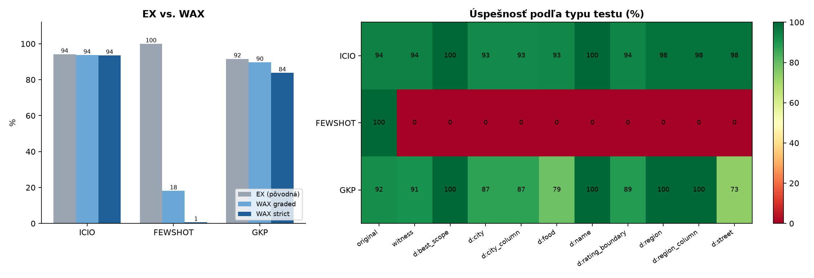

# Task 3 – Nová metrika: Witness-Augmented Execution Accuracy (WAX)

## Problém pôvodnej metriky

Pôvodná metrika (execution accuracy, EX) spustí predikovaný dotaz nad jednou databázou a porovná vrátené riadky so správnym výsledkom. Hodnotí teda **výsledok**, nie to, či dotaz otázku naozaj rieši. V tomto datasete to má tri slabiny:

- **43 zo 155 správnych výsledkov (28 %) je prázdnych.** Dotaz `WHERE 1 = 0` ich všetky trafí bez ohľadu na otázku. Presne toto sa stalo pri Few-Shot v Task 2.
- **Napevno opísané riadky prejdú.** Agent s prístupom k `restaurants_dataset.csv` môže vrátiť `VALUES (151, 'thai house'), ...` a získať 100 %.
- **Hodnotenie je binárne a bez diagnostiky.** Nevieme, či model zlyháva na meste, hranici ratingu alebo na „the best“.

## Definícia metriky

WAX spustí každý predikovaný dotaz nielen na pôvodnej databáze, ale aj na sérii **cielene zmutovaných databáz** vytvorených pre konkrétnu otázku:

| Test                                       | Čo sa do DB vloží                                 | Správny dotaz musí…    | Overuje                                     |
| ------------------------------------------ | ---------------------------------------------------- | ------------------------- | ------------------------------------------- |
| `original`                                 | nič                                                 | vrátiť zlatý výsledok | to isté ako EX                             |
| `witness`                                  | reštauráciu spĺňajúcu všetky podmienky otázky | vrátiť ju               | že dotaz skutočne filtruje podľa otázky |
| `decoy_city`                               | svedka v inom meste                                  | nevrátiť ju             | filter mesta                                |
| `decoy_city_column`                        | svedka s iným mestom v LOCATION                     | nevrátiť ju             | správny stĺpec mesta                      |
| `decoy_region`, `decoy_region_column`      | svedka mimo regiónu                                 | nevrátiť ju             | filter a join regiónu                      |
| `decoy_street`, `decoy_food`, `decoy_name` | svedka s inou ulicou, jedlom, názvom                | nevrátiť ju             | daný filter                                |
| `decoy_rating_boundary`                    | svedka s ratingom presne X                           | nevrátiť ju             | ostré`>`                                   |
| `decoy_best_scope`                         | lepšie hodnoteného svedka mimo rozsahu             | nevrátiť ju             | filtre v MAX podotázke                     |

Každá návnada (decoy) porušuje práve jednu podmienku. Návnada sa počíta ako splnená, len ak dotaz pri tej istej otázke vrátil aj svedka. Inak by konštantný dotaz „odmietol“ všetky návnady zadarmo.

Očakávaný výsledok na každej mutácii počíta **referenčný dotaz** odvodený z textu otázky. Referencia sa použije len vtedy, ak na pôvodnej DB presne reprodukuje zlatý výsledok, čo platí pre 154 zo 155 otázok. Jediná výnimka („What is the lifes greates illusion?“) sa hodnotí len na pôvodnej DB, rovnako ako pri EX. Spolu ide o 735 mutačných testov.

Metrika má tri výstupy:

- **WAX strict** – podiel otázok, pri ktorých dotaz prejde všetkými testami. Toto je hlavné číslo.
- **WAX graded** – priemerný podiel splnených testov na otázku, teda čiastočné body.
- **Hollow hits** – otázky správne podľa EX, ale neúspešné podľa WAX. Ide o „trafené“ výsledky.

## Prečo je to dobrá metrika

- **Meria to, čo chceme.** Otázka v praxi znie: „vráti tento dotaz správne reštaurácie aj zajtra, keď pribudnú nové?“ WAX to testuje priamo pridaním nových reštaurácií.
- **Je odolná voči podvodom a úniku dát.** Svedok sa vkladá až pri hodnotení a model ho nikdy nevidí. Konštantný alebo napevno opísaný dotaz ho nemôže vrátiť, aj keby mal model prístup k zlatým výsledkom, ako v Task 2.
- **Je diagnostická.** Profil po typoch testov ukáže, ktorú konvenciu prompt nezvládol.
- **Je deterministická a lacná.** Nepotrebuje LLM-sudcu ani ručné anotácie a používa len existujúcu DB a zlaté výsledky. Beh trvá sekundy.
- **Je originálna.** Známa „test-suite accuracy“ (Zhong et al., 2020) používa náhodne generované databázy. WAX namiesto toho cielene vkladá jedného svedka a jednu návnadu na každú podmienku otázky. Vďaka tomu priamo ukáže, ktorá podmienka zlyhala.

**Obmedzenia.** Referenčné dotazy vyžadujú parser otázok; pri šablónovom datasete ako tento je to jednoduché, pri voľnom jazyku by bolo náročnejšie. Metrika tiež vynucuje konvencie odvodené zo zlatých výsledkov, napr. mesto cez `LOCATION.CITY_NAME`. Dotaz s inou, „rozumnou“ konvenciou preto prísne penalizuje, čo je zámer, ale treba to pri interpretácii vedieť.

## Dopĺňa alebo nahrádza EX?

**Dopĺňa.** Test `original` je presne EX, takže platí WAX ≤ EX. WAX je prísnejšie spresnenie, nie iné meranie. Odporúčam vždy uvádzať obe čísla: rozdiel EX − WAX (hollow hits) sám osebe meria, koľko úspechu je náhodného alebo podvodného. V prostredí, kde model môže vidieť zlaté výsledky (ako v Task 2), by mal byť hlavným číslom WAX.

## Overenie metriky

Kým nebudú k dispozícii predikcie z Task 2, overil som metriku na piatich syntetických sadách predikcií (`make_demo_predictions.py`):

| Sada            | Čo simuluje                                         | EX     | WAX strict | WAX graded | Hollow hits |
| --------------- | ---------------------------------------------------- | ------ | ---------- | ---------- | ----------- |
| A_reference     | správne riešenie                                   | 100 %  | 100 %      | 100 %      | 0           |
| B_empty_oracle  | `WHERE 1 = 0` pri prázdnom výsledku (ako Few-Shot) | 100 %  | 72,3 %     | 77,4 %     | 43          |
| C_values_oracle | napevno opísané zlaté výsledky                   | 100 %  | 0,6 %      | 18,2 %     | 154         |
| D_city_column   | mesto cez`RESTAURANT.CITY_NAME`                      | 95,5 % | 29,0 %     | 84,2 %     | 103         |
| E_rating_gte    | `>=` namiesto `>`                                    | 78,7 % | 29,7 %     | 70,8 %     | 76          |

EX nerozlíši správne riešenie (A) od dvoch podvodov (B, C), všetky majú 100 %. WAX ich oddelí a teplotná mapa presne ukáže príčinu. B zlyháva na svedkoch pri otázkach s prázdnym výsledkom, C na všetkých svedkoch, D na teste `d:city_column` a E na `d:rating_boundary`.

## Výsledky promptov z Task 2

| Prompt   | EX       | WAX strict | WAX graded | Hollow hits |
| -------- | -------- | ---------- | ---------- | ----------- |
| ICIO     | 94,19 %  | 93,55 %    | 93,71 %    | 1           |
| Few-Shot | 100,00 % | 0,65 %     | 18,15 %    | 154         |
| GKP      | 91,61 %  | 83,87 %    | 89,69 %    | 12          |

Podľa WAX je najlepší ICIO, Few-Shot je posledný: jeho dotazy nereagujú na nové dáta, čo zodpovedá opísaným zlatým výsledkom. Podrobný rozbor je v `results_report.md`.

## Súbory

- `witness_metric.py` – implementácia metriky (dáta a `evaluate_retrieval_predictions.py` hľadá v `../Task_2/data` alebo vo vlastnom priečinku)
- `make_demo_predictions.py` – syntetické predikcie na overenie metriky
- `results_report.md` – krátky report s výsledkami promptov podľa WAX
- `wax_results.csv`, `wax_details.csv`, `wax_comparison.png` – výstupy metriky pre prompty z Task 2 (vytvorí `witness_metric.py`)
- `demo_results/` – výsledky overenia (`wax_results.csv`, `wax_details.csv`, `wax_comparison.png`)
