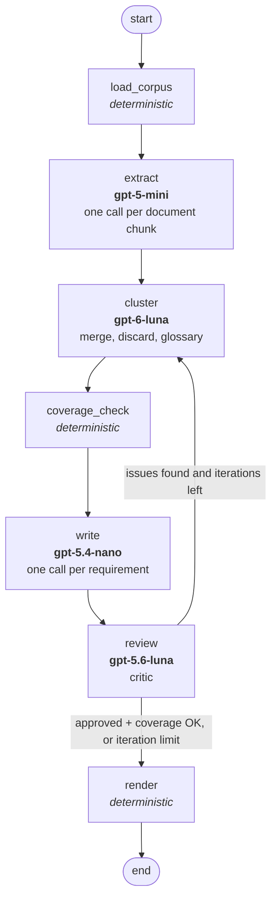

# Report: Agentic Network for Requirements Refinement

## 1. Overview

The network takes a directory of heterogeneous documents (email threads, meeting minutes,
interviews, a survey, a draft SRS, reference documentation) and produces one structured
requirements specification in Markdown. It is implemented in LangGraph (`graph.py`) and uses the
OpenAI API through `langchain-openai`. Every LLM node returns **structured output** validated by
Pydantic models (`schemas.py`), so the data passed between nodes is typed JSON rather than free text.

## 2. Nodes

| Node | Kind | Model | Responsibility |
|---|---|---|---|
| `load_corpus` | deterministic | – | Recursively reads `.txt`, `.md`, `.eml` files from the input directory (no hard-coded file names). Assigns each a document ID (relative path), detects the document kind from the file name and the date from the file name / `Date:` header / first written date. |
| `extract` | LLM | `gpt-5-mini` | Extracts every candidate requirement from each document (documents over 20,000 characters are split on paragraph boundaries). Each candidate has a title, a "The system shall…" statement, type, *source status* (agreed / proposed / rejected / deferred / questioned) and a verbatim evidence quote. The node then deterministically gives each candidate an ID `C-xxx` and attaches its source document and date. |
| `cluster` | LLM | `gpt-6-luna` | Decides the *structure* of the specification: groups semantic duplicates into requirements (lists of candidate IDs), discards conflicting/rejected/out-of-scope candidates with a reason, assigns categories and types, and builds a glossary of preferred terms and synonyms to avoid. On later iterations it returns a **patch** (requirements to add or replace, keys to remove) based on the reviewer's feedback and the coverage report. The node applies the patch to the previous version in code. |
| `coverage_check` | deterministic | – | Makes every candidate ID used **exactly once** (in a requirement or in the blacklist). It repairs what can be fixed safely: normalises ID spelling (`C034` → `C-034`), drops invented IDs, removes repeated uses (first occurrence wins), renames duplicate keys and deletes empty requirements. What it cannot fix (missing candidates, duplicate names) is reported to the reviewer and the next `cluster` round. |
| `write` | LLM | `gpt-5.4-nano` | Writes the final name, one-paragraph description, priority and priority rationale for each requirement, in parallel. It sees all merged candidates (with evidence, status and dates), the glossary, the other requirement names in the same category, and the reviewer comments for that requirement. A cache keyed by the candidate-ID set means later iterations only rewrite requirements that changed or were criticised. |
| `review` | LLM | `gpt-5.6-luna` | Independent critic. Checks for duplicates, conflicts, vocabulary violations, candidates whose content was lost, wrong priorities, poor quality and wrong traceability. Returns `approved` and a list of concrete issues with affected keys and suggested fixes. |
| `render` | deterministic | – | Assigns final IDs `REQ-001…` (sorted by category, priority, name) and `DIS-001…`, replaces temporary keys in all texts, computes source documents for each requirement **from the candidate IDs** (not from LLM claims), and writes the Markdown document. |

### Feedback loop

`review` → `route_after_review` → `cluster` is the feedback loop (ANS3). The loop ends when the
reviewer approves **and** the deterministic coverage check passes, or after `--max-iterations`
rounds (default 3). Two different checkers feed the loop: a deterministic one, which is exact for
bookkeeping errors (lost or duplicated candidates), and an LLM one, which is needed for semantic
errors (duplicates, contradictions, vocabulary).

An LLM revision can also make things worse, so `review` scores every iteration
(2 × missing candidates + duplicate names + reviewer issues) and keeps the best version in the
state. `render` renders that version, not necessarily the last one. Its remaining reviewer issues
are not hidden; they are listed in the "Quality assurance log" section of the document.

## 3. Design choices

**Extract per document, consolidate globally.** Processing one document (chunk) at a time keeps
each extraction prompt small, so the model reads the whole text carefully, and runs in parallel.
Deduplication and conflict resolution need the global view, so they happen in a single later step.

**Separating structure (`cluster`) from prose (`write`).** The first version had one
`consolidate` node that did both in a single call over ~700 candidates. Under that output-length
pressure the model produced only ~30 very broad "catalogue" requirements (one merged 46 candidates).
The reviewer kept flagging overlaps and lost details, and on revision the model even dropped 57
candidates. After the split:
- `cluster` outputs only IDs and short names, so it can afford fine-grained requirements
  (~190, typically 1–10 candidates each), and the prompt asks explicitly for one cohesive,
  testable capability per requirement.
- `write` sees every merged candidate with its evidence, so details are preserved. Its calls are
  independent, so they are cheap, parallel and cacheable.

**Revisions as patches and a "keep the best" guard.** In the next version, each `cluster` revision
regenerated the whole structure from scratch. In one full run this went wrong: round 1 put 377
candidates into several requirements, and round 3 lost 249 candidates and produced duplicate keys.
The final, rendered version was therefore the worst one. Three changes made the loop safe:
- Revisions are patches merged in code, so requirements the model does not mention cannot be lost.
- `coverage_check` repairs bookkeeping errors deterministically.
- The best-scoring iteration is rendered instead of the last one.

**Model assignment (ANS4: four different models).**
- `gpt-6-luna` (strongest) for `cluster`: the hardest step, which needs global reasoning over
  hundreds of items.
- `gpt-5.6-luna` for `review`: a different model from the one that produced the structure, so it
  doesn't share the producer's blind spots.
- `gpt-5-mini` for `extract`: about 21 medium-sized reading tasks that need good recall at low cost.
- `gpt-5.4-nano` for `write`: about 200 small, well-scoped summarisation tasks where speed and cost
  matter most.

All models can be changed through environment variables (`config.py`).

**Deterministic where possible.** IDs, source tracing, coverage accounting and document layout
are all done in code. An LLM is never trusted to number requirements, report sources or format the
document, because those things must be exactly right.

**Source status and dates for conflict resolution.** Extraction records whether a statement was
agreed, proposed, rejected, deferred or only questioned, and the loader records document dates.
The cluster prompt resolves conflicts in favour of more recent and more authoritative decisions
(agreed in a meeting > proposed in an email).

**Generality.** Nothing is specific to this corpus: the input directory is a CLI argument, file
discovery is recursive by extension, and the prompts describe generic requirements-engineering
tasks. `--reuse-candidates` lets you skip extraction while debugging the later stages.

## 4. Mapping of the specifications to network elements

| Spec | Where it is addressed |
|---|---|
| ANS1 ≥3 LLM nodes | `extract`, `cluster`, `write`, `review` (4) |
| ANS2 ≥1 deterministic node | `load_corpus`, `coverage_check`, `render` (3) |
| ANS3 feedback loop | `review` → conditional edge → `cluster` (with `coverage_check` results), max N iterations |
| ANS4 ≥3 models | `gpt-5-mini`, `gpt-6-luna`, `gpt-5.4-nano`, `gpt-5.6-luna` |
| ANS5 LangGraph | `graph.py` – `StateGraph` with typed `GraphState` |
| OS1 single structured document | `render` → `output/requirements.md` with fixed sections (priority scale, glossary, requirements by category, traceability matrix, blacklist, QA log, source list) |
| OS2 unique IDs | `extract` assigns `C-xxx` to candidates; `render` assigns `REQ-xxx` / `DIS-xxx` deterministically |
| OS3 no duplicates | `cluster` prompt task 1–2 (merge duplicates, no overlapping scope); `review` checks `duplicate`; `write` prompt says to state each fact once; `coverage_check` flags duplicate names |
| OS4 tracing | Every candidate carries its source document; requirements list their candidate IDs; `render` derives sources and builds a document → requirement traceability matrix |
| OS5 name + paragraph | `RequirementCluster.name` from `cluster`; `write` produces the name and a 3–6 sentence paragraph (schema field descriptions + prompt) |
| OS6 priority + explained scale | MoSCoW scale defined once in `prompts.PRIORITY_SCALE`, used in the `write` prompt and printed in section 1 of the document; each requirement has a priority rationale |
| OS7 consistency | Glossary with preferred terms and synonyms to avoid (`cluster`), passed to `write`; conflict-resolution rules in `cluster`; `review` checks `vocabulary` and `conflict` |
| OS8 completeness | Exhaustive per-document extraction; "every candidate exactly once" rule in `cluster`; patch-based revisions so nothing is silently lost; deterministic `coverage_check` in the loop; `review` checks `missing`; missing candidates are weighted twice in the iteration score; any candidates still unmapped are printed in the QA section |
| OS9 blacklist | `cluster` puts conflicting, rejected, superseded, nonsensical and out-of-scope candidates into `discarded` with a reason category and explanation; `render` writes section 5 |

## 5. Results on the provided corpus

Final run (`python main.py --input data/corpus`, about 8.5 minutes, log in `output/run.log`):

| Stage | Result |
|---|---|
| `load_corpus` | 20 documents (9 email threads in a subfolder, 3 other emails, 3 meeting minutes, 2 interviews, survey, draft SRS, reference doc), 21 chunks |
| `extract` | 752 candidate requirements (~4 min, the slowest step) |
| Iteration 1 | 250 requirements. `coverage_check` auto-removed 52 repeated candidate uses and 22 empty requirements; 14 candidates missing; 16 reviewer issues → score 44 |
| Iteration 2 | Patch places all missing candidates → **coverage OK**; 14 reviewer issues → score 14 |
| Iteration 3 | Coverage OK; 11 reviewer issues → score 11 (best, rendered) |
| Output | **237 requirements** in 5 categories, 12 glossary terms, 4 discarded, 237 + 4 entries tracing back to 20 documents |

Priorities: 118 Must, 110 Should, 9 Could, 0 Won't. All 752 candidates are accounted for
(every one is in exactly one requirement or in the blacklist). The median requirement merges 2
candidates; the largest merges 20.

**Development history (why the design looks like this):**

| Run | Design | Outcome |
|---|---|---|
| 1 | single `consolidate` node (structure + prose in one call) | only 31 overly broad requirements; 24 candidates lost |
| 2 | `cluster` + `write` split, full regeneration per round | 196 requirements, coverage nearly clean, but descriptions repeated themselves |
| 3 | + writer prompt fixes | unstable: last round lost 249 candidates and was rendered anyway |
| 4 (final) | + patch-based revisions, deterministic repair, best-version selection | 237 requirements, full coverage from round 2 onward, issues reduced 16 → 14 → 11 |

**Observations on the final document.**
- The four blacklisted items are all project-management tasks assigned to named people
  (e.g. "provide a deletion trigger"), which correctly don't belong in a product specification.
- In this run the clustering resolved conflicting candidates by merging them into a single
  requirement rather than blacklisting them. An earlier run blacklisted, for example, "optional
  Excel output" as superseded by a later agreed decision.
- The reviewer still reports 11 open issues: 2 partial duplicates, some glossary terms not used
  ("ILS" vs. "Library Automation System"), vague wording, and one scope conflict between "the
  system does not manage cataloging" and the cataloging utilities. They are listed in section 6
  of the output for the reader.
- The priority distribution leans towards Must. Many candidates in the minutes are recorded as
  "agreed", which the scale maps to Must.

## 6. Limitations and possible improvements

- The reviewer is strict and keeps finding new, increasingly subtle issues, so it rarely sets
  `approved=true` within 3 iterations. Open issues are documented in the output, not hidden.
- The quality of the requirement texts depends on the small `write` model. A stronger model there
  would give better prose at a higher cost.
- `cluster` is a single call over all candidates. For much larger corpora (thousands of candidates)
  it would have to be split, e.g. by first assigning categories and then clustering per category.
- Conflict detection is only as good as the LLM's semantic judgement. There is no formal
  consistency check.

## 7. Files

See `README.md` for usage. Outputs are in `output/`: `requirements.md` (the deliverable),
`candidates.json`, `specification.json`, `review_log.json`, `graph.mmd` (diagram generated by LangGraph).
