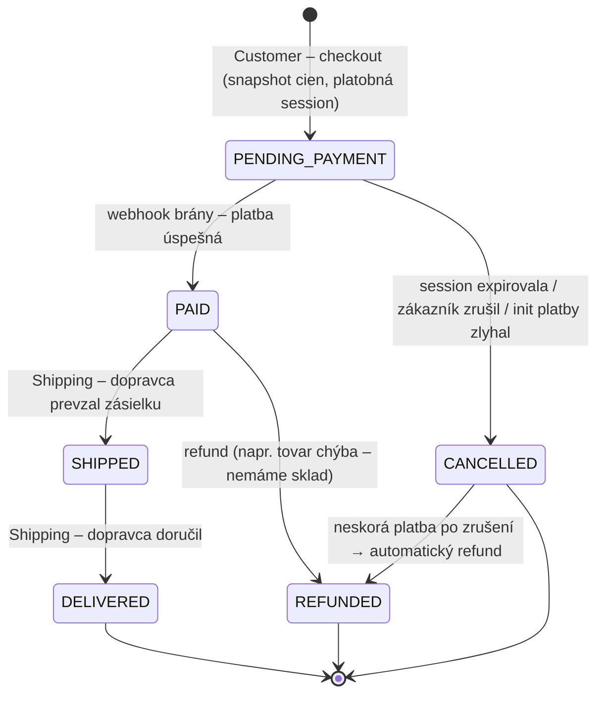

# NOTES – Architektúry pre CDC Shop

Priebežné poznámky z diskusie o architektúrach (Task 1). Nie je to doslovný záznam, ale stav poznania po každej podstatnej výmene.
Zdroj požiadaviek: [data/CDC.txt](data/CDC.txt)

---

## 1. Zhrnutie systému

**Čo to je:** e-shop s materiálom zo železiarstva (hardware store). Spec ho explicitne nazýva *distribuovaný systém*, ktorý rieši správu produktov, platbu a doručenie.

**Používatelia (roly):**
| Rola | Čo robí |
|---|---|
| Customer | registrácia, login/logout, profil, prehliadanie a vyhľadávanie produktov, košík, platba, sledovanie objednávky, kontakt na obchod |
| Merchant | login/logout na Merchant page, profil, prehliadanie produktov, pridanie/odobratie produktu, zmena ceny |
| (implicitne) externé systémy | platobná brána, dopravca (zásielka) |

**Funkčné oblasti (bounded contexts):**
- **Identity** – registrácia, login, logout, profil (US 1, 2, 3, 8, 13, 14, 19)
- **Catalog** – zoznam, detail, vyhľadávanie podľa názvu, triedenie podľa ceny (US 5, 6, 11, 12, 17, 18, 21, 22); správa produktov a cien (US 15, 16)
- **Cart** – zobraziť, pridať, vyprázdniť (US 4, 24, 25)
- **Ordering + Payment** – zaplatiť košík (US 7)
- **Shipping** – info o zásielke (US 9)
- **Content / Contact** – About Us, kontakt na obchod (US 10, 20, 23)

**Nefunkčné požiadavky** (v spec nie sú explicitne, odvodené):
- **Bezpečnosť platieb** – nikdy neukladať údaje o kartách → hosted platobná stránka / tokenizácia (PCI DSS, SAQ-A).
- **Bezpečnosť identity** – hashovanie hesiel (Argon2/bcrypt), oddelenie rolí Customer/Merchant (RBAC).
- **GDPR** – osobné údaje v profile, právo na výmaz, adresy doručenia.
- **Konzistencia peňazí a skladu** – objednávka nesmie byť zaplatená dvakrát, nesmie sa predať viac kusov, než je na sklade.
- **Výkon čítania** – katalóg/vyhľadávanie je read-heavy, checkout je write-critical.
- **Dostupnosť** – výpadok platobnej brány/dopravcu nesmie zhodiť celý obchod.
- **„Distribuovaný"** – minimálne klient–server + externé integrácie; neznamená to automaticky mikroslužby.

**Obmedzenia a nejasnosti v zadaní (treba sa rozhodnúť alebo spýtať):**
1. **Jeden alebo viac merchantov?** „Merchant page" + „my profile" → môže to byť jeden obchod s viacerými zamestnancami, alebo marketplace. Zásadne mení dátový model (vlastníctvo produktu).
2. **Sklad (inventory)** nie je spomenutý, ale pre železiarstvo je prakticky nevyhnutný (kusy, metre, kilá – merné jednotky!).
3. **Chýba merchant strana objednávok** – nikto nevidí objednávky ani neoznačí „odoslané". US 9 (stav zásielky) teda vyžaduje buď integráciu s dopravcom, alebo chýbajúcu user story.
4. **Guest checkout / anonymný košík** nie je spomenutý → predpoklad: košík len pre prihláseného zákazníka.
5. **Kontakt (US 23)** – formulár → e-mail? ticketing? chat? Predpoklad: formulár → e-mail + uloženie.
6. **Zmena ceny produktu, ktorý je v košíku** – spec nehovorí, čo sa stane.
7. **Odstránenie produktu, ktorý je v objednávkach** – musí ostať historicky (soft delete).

---

## 2. Tri navrhnuté architektúry

### A) Modulárny monolit (vrstvený, s jasnými hranicami modulov)
- **Komponenty:** SPA (alebo SSR web) → jeden backend (moduly Identity, Catalog, Cart, Ordering, Payment, Shipping, Contact) → jedna PostgreSQL (schéma per modul) → externé: platobná brána (webhooky), API dopravcu, SMTP.
- **Komunikácia:** moduly cez in-process verejné rozhrania (fasády) + in-process doménové udalosti; žiadne cudzie tabuľky.
- **Kľúčové mechanizmy:** stavový automat objednávky (CREATED → PENDING_PAYMENT → PAID → SHIPPED → DELIVERED / CANCELLED), idempotentný webhook handler, podmienený update skladu, snapshot ceny do order_line, pg_trgm/full-text pre vyhľadávanie, keyset stránkovanie.
- **+** jednoduchý vývoj, deploy, debug; ACID transakcie; lacná prevádzka; rýchly štart.
- **–** škálovanie len celé naraz; erózia hraníc modulov; jeden deploy = jedno riziko; „distribuovaný" len v zmysle klient/server + externé služby.
- **Najťažšie:** platba mimo DB transakcie (webhooky, idempotencia, rekonciliácia), oversell skladu, disciplína hraníc modulov, vyhľadávanie s diakritikou.
- **Kedy:** malý tím (1–6 ľudí), jeden obchod, MVP, stredná záťaž. **Moja predvolená voľba.**

### B) Mikroslužby + event-driven (sága pre checkout)
- **Komponenty:** API Gateway/BFF → služby Identity (napr. Keycloak), Catalog, Search (read model), Cart, Order, Inventory, Payment, Shipping, Notification; každá vlastná DB; message broker (Kafka/RabbitMQ).
- **Komunikácia:** synchrónne REST/gRPC pre dotazy, asynchrónne udalosti pre zmeny stavu; checkout ako sága (choreografia alebo orchestrácia) s kompenzáciami.
- **Kľúčové mechanizmy:** transactional outbox, idempotentní konzumenti, partitioning podľa kľúča, CQRS read model pre vyhľadávanie, JWT validácia, distributed tracing.
- **+** nezávislé škálovanie a deploy, izolácia zlyhaní, tímová autonómia, pripravené na marketplace.
- **–** obrovská prevádzková a kognitívna záťaž, eventuálna konzistencia, ťažké testovanie a lokálny vývoj, drahé.
- **Najťažšie:** dual-write (outbox), at-least-once doručenie + duplicity, kompenzácie ságy, verzovanie udalostí, logout s JWT, reporting naprieč službami.
- **Kedy:** viac tímov, veľké/nerovnomerné zaťaženie, plán na marketplace s mnohými predajcami, organizácia s DevOps zrelosťou.

### C) Serverless / managed-services (cloud-native, „BaaS")
- **Komponenty:** statické SPA na CDN → managed IdP (Cognito/Auth0) → API Gateway → funkcie (Lambda) → DynamoDB; Stripe Checkout (hosted) + webhook funkcia; Step Functions pre workflow objednávky; EventBridge; vyhľadávanie cez Algolia/OpenSearch synchronizované z DynamoDB Streams; SES pre kontakt.
- **Komunikácia:** HTTP → funkcie; udalosti cez Streams/EventBridge; orchestrácia cez Step Functions.
- **+** takmer žiadna prevádzka serverov, platba za použitie, automatické škálovanie na špičky (výpredaje), identita „zadarmo".
- **–** vendor lock-in, cold starty, zložité lokálne testovanie, DynamoDB vyžaduje návrh podľa prístupových vzorov, nepredvídateľné náklady pri veľkej záťaži.
- **Najťažšie:** triedenie podľa ceny + vyhľadávanie v DynamoDB (hot partition, potreba externého search), idempotencia pri retry funkcií, limity transakcií, IAM, observabilita, obmedzenia Cognito.
- **Kedy:** malý tím bez ops kapacity, nárazová záťaž, akceptovaný lock-in, rýchly time-to-market.

---

## 3. Log diskusie

- **2026-11-01 – štart:** Prečítaný CDC.txt, zhrnutie systému, identifikované nejasnosti (merchant model, sklad, chýbajúca merchant správa objednávok). Navrhnuté 3 architektúry A/B/C. Čakám na otázky.

- **Rozhodnutie 1 – jeden obchod, bez skladu:** Používateľ potvrdil, že je to **jeden obchod** (nie marketplace) a **sklad priamo neriešime**. Dopady:
  - *Jeden obchod:* produkty patria obchodu, nie konkrétnemu merchantovi → žiadna kontrola vlastníctva, stačí rola `MERCHANT` (každý merchant môže editovať všetko). Merchant účty nevznikajú registráciou (žiadna US) → vytvárajú sa seedom/administrátorsky. Odpadá multi-tenant dátový model, rozúčtovanie platieb (split payments), provízie.
  - *Bez skladu:* zmizne problém oversell a rezervácií → checkout = košík → objednávka (snapshot cien) → platba → zásielka. Dostupnosť riadi merchant pridaním/odobratím produktu (US 16). Akceptované riziko: predaj tovaru, ktorý fyzicky chýba → rieši sa ručne (storno + refund). Odporúčanie do budúcna: aspoň príznak `available` na produkte (lacné, nemení architektúru).
  - *A (monolit):* ešte jednoduchší; ostáva ako najťažšie: platobné webhooky, zmena ceny počas nákupu, soft delete, vyhľadávanie.
  - *B (mikroslužby):* odpadá Inventory služba aj najzložitejšia časť ságy (kompenzácia rezervácie); sága sa skracuje na Order → Payment → Shipping. Zároveň **slabnú hlavné argumenty pre B** (marketplace, nezávislé tímy) → rozumná redukcia na ~4 služby, inak predimenzované.
  - *C (serverless):* odpadajú transakčné limity DynamoDB pre sklad; ostáva problém vyhľadávania/triedenia a idempotencie. Pri malom katalógu (stovky–nízke tisíce položiek) je možný aj dočasný kompromis bez externého search enginu.

- **Otázka 2 – odkiaľ sú NFR a ktorá rozhoduje:** Priznané, že NFR sú **odvodené** (zo zadania je len slovo „distribuovaný"). Kľúčový postreh: väčšina odvodených NFR (PCI, GDPR, heslá, RBAC) sú **hygienické** – spĺňajú ich všetky tri architektúry rovnako (hosted payment page, hashovanie, roly), takže výber **neovplyvňujú**. Výber rozhodujú atribúty, v ktorých sa A/B/C líšia: **prevádzkovateľnosť (veľkosť tímu / ops kapacita)**, **profil záťaže a škálovateľnosť**, **dostupnosť / izolácia zlyhaní**, **konzistencia**, **náklady** a **lock-in**. Tie zadanie neuvádza → treba ich predpokladať.
  - Najviac rozhodujúca: **prevádzkovateľnosť vs. škálovateľnosť** (koľko ľudí to bude prevádzkovať a aká je záťaž). Pri predpoklade „regionálny obchod, malý tím, sezónne špičky" vychádza A (príp. C pri nulovej ops kapacite); B len pri požiadavke na nezávislé škálovanie/izoláciu.
  - Druhá v poradí: **konzistencia platby** – nutná všade, ale A ju dáva najlacnejšie (ACID), B/C ju musia skladať (sága, idempotencia).
  - Navrhnuté pracovné predpoklady NFR (čakajú na potvrdenie): ~1–5 tis. návštev/deň, špičky 10× (sezóna/akcie), katalóg do ~5 000 položiek, tím 2–4 vývojári bez dedikovaného ops, dostupnosť 99,5 %, odozva katalógu < 500 ms p95.

- **Otázka 3 – protirečí „distribuovaný systém" monolitu A?** Nie nutne, ale napätie je legitímne a treba ho v ADR explicitne adresovať.
  - **Monolit** = granularita *nasadzovacej jednotky* (jeden build, jeden deploy). **Distribuovaný** = komponenty bežia na viacerých uzloch a komunikujú cez sieť s rizikom čiastočných zlyhaní. Sú to ortogonálne osi.
  - A v nasadení je distribuovaný: prehliadač ↔ N inštancií backendu za LB ↔ DB (príp. replika) ↔ Redis ↔ platobná brána ↔ dopravca ↔ SMTP. Najťažšie problémy A (webhook príde 2×/neskoro/vôbec, timeouty, rekonciliácia) sú **typické problémy distribuovaných systémov**.
  - Ak však zadanie myslí „biznis funkcie rozdelené do samostatne bežiacich služieb", A je slabá interpretácia → **overiť u zadávateľa**.
  - Kompromis **A′**: modulárny monolit (API) + samostatný **worker** proces + **message queue** pre asynchrónne veci (spracovanie webhookov, vytvorenie zásielky, e-maily z kontaktu). Viac procesov, nezávislé zlyhanie integrácií, stále jedna DB vlastnená monolitom.
  - Varovanie: **distribuovaný monolit** (služby so zdieľanou DB, ktoré sa musia nasadzovať spolu, synchrónne reťazenie volaní) = najhoršie z oboch svetov. Pri posune A → B sa mu treba vyhnúť.

- **Otázka 4 – deep dive A: modulárny vs. obyčajný monolit, architektonické testy, idempotentný webhook:**
  - **Obyčajný monolit** = členenie podľa technických vrstiev (controllers / services / repositories / entities), čokoľvek môže volať čokoľvek, zdieľané entity a JOINy naprieč doménami → časom „big ball of mud".
  - **Modulárny monolit** = členenie **vertikálne podľa domén** (identity, catalog, cart, ordering, payment, shipping, contact); každý modul má **verejné API** (fasáda + DTO) a **skryté vnútro**; **vlastní svoje dáta** (vlastná schéma, žiadne cudzie FK/JOINy, odkaz len cez ID); komunikácia cez fasády alebo in-process udalosti. Modul sa dá neskôr vytiahnuť do služby.
  - Príklad CDC: objednávka v obyčajnom monolite odkazuje cez FK/ORM vzťah na Product → po zmene ceny/zmazaní produktu sa „zmení" história objednávok. V modulárnom Ordering získa od Catalog fasády DTO a **uloží si kópiu** (názov, cena) → snapshot vzniká prirodzene.
  - Cena modularity: duplicitné DTO, žiadne pohodlné JOINy, pohľady naprieč modulmi (napr. prehľad objednávok s názvami produktov) treba skladať.
  - **Architektonické testy** = automatické testy **štruktúry kódu** (závislosti medzi balíčkami, vrstvy, cykly, pomenovanie), bežia v CI a zhodia build pri porušení. Nástroje: ArchUnit (Java), ArchUnitNET/NetArchTest (.NET), Spring Modulith, dependency-cruiser (JS/TS), import-linter (Python), deptrac (PHP). Pravidlá pre CDC: nikto mimo modulu nesiahne na jeho `internal`; moduly bez cyklov; SDK platobnej brány len v payment/infrastructure; doména nezávisí od frameworku.
  - Limity: vidia len statické závislosti v kóde, nie SQL do cudzej schémy → doplniť **DB oprávnenia per modul** (samostatný DB user/schéma). Silnejšia alternatíva: samostatné build moduly (Gradle/Maven, .NET projekty) → hranicu vynúti kompilátor.
  - **Idempotentný webhook handler**: idempotentná operácia = n-násobné vykonanie má rovnaký efekt ako jedno. Brány doručujú webhooky **at-least-once** (retry pri timeoute / ne-2xx) → duplicity, súbežné doručenia, iné poradie. Bez idempotencie: 2× zásielka, 2× e-mail.
  - Postup: (1) overiť **podpis** (HMAC + časová tolerancia); (2) **deduplikácia podľa event ID** – tabuľka spracovaných udalostí s **unique constraint**, zápis v tej istej DB transakcii ako zmena stavu; (3) **strážca stavového automatu** – podmienený prechod PENDING_PAYMENT → PAID, inak no-op; (4) overiť sumu a menu; (5) vedľajšie efekty (zásielka, e-mail) nie priamo v handleri, ale cez udalosť/job, samé idempotentné (idempotency key = order ID); (6) rýchlo vrátiť 2xx.
  - Doplnky: **redirect späť z brány nie je dôkaz platby**; chýbajúci webhook rieši **rekonciliačný job** (dopyt na bránu pre staré PENDING_PAYMENT); pri vytváraní platobnej session posielať **Idempotency-Key** smerom k bráne.

- **Otázka 5 – stavový diagram objednávky (A):**
  - **Korekcia:** stav `CREATED` z pôvodného návrhu vypúšťam – objednávka vzniká rovno v `PENDING_PAYMENT`; zlyhanie vytvorenia platobnej session = `CANCELLED` (reason `PAYMENT_INIT_FAILED`). Neúspešný pokus o platbu (zamietnutá karta) **nie je stav** – zákazník skúša znova na stránke brány, objednávka ostáva v `PENDING_PAYMENT`.
  - **Oddelenie dvoch životných cyklov:** `Order` (hrubé biznis stavy, modul Ordering) vs. `Shipment` (jemné stavy dopravcu, modul Shipping: LABEL_CREATED, IN_TRANSIT, OUT_FOR_DELIVERY, DELIVERED, EXCEPTION, RETURNED). US 9 zobrazuje detail zo Shipment; Order reaguje len na kľúčové udalosti (odoslané, doručené).

  | Prechod | Kto/čo ho spúšťa | Kedy |
  |---|---|---|
  | → PENDING_PAYMENT | Customer (US 7) cez Ordering | klik „Zaplatiť"; v 1 transakcii: objednávka + snapshot cien |
  | PENDING_PAYMENT → PAID | webhook brány (idempotentný handler) alebo rekonciliačný job | po úspešnej platbe |
  | PENDING_PAYMENT → CANCELLED | webhook „session expired", zákazník (návrat „zrušiť"), rekonciliačný job | expirácia session (napr. 30–60 min) |
  | PAID → SHIPPED | modul Shipping (udalosť dopravcu cez webhook/polling) | dopravca prevzal balík |
  | SHIPPED → DELIVERED | modul Shipping | dopravca potvrdil doručenie |
  | PAID → REFUNDED | merchant/obsluha (cez dashboard brány – **chýba US**) → webhook „refunded" | tovar nie je k dispozícii |
  | CANCELLED → REFUNDED | systém automaticky | platba dorazila po zrušení (race) |

  - **Race „neskorá platba":** timeout u nás nesmie predbehnúť bránu. Pravidlo: **brána je zdroj pravdy** – pred zrušením session aktívne expirovať na bráne; ak to brána odmietne, lebo je už zaplatená → PAID. Ak aj tak príde platba po CANCELLED → automatický refund + záznam, objednávku „nevzkriesiť".
  - **Košík sa vyprázdni až pri PAID** (udalosť OrderPaid → Cart), nie pri vytvorení objednávky – inak by zákazník pri nedokončenej platbe prišiel o košík.
  - **Implementačné zásady:** prechody len cez metódy agregátu Order; tabuľka povolených prechodov; podmienený update (`WHERE status = očakávaný`); tabuľka **histórie stavov** (from, to, čas, aktér, dôvod, ID zdrojovej udalosti) → audit + časová os pre US 9.
  - **Medzera v zadaní:** merchant nemá US na refund ani na kontrolu objednávok → buď manuálne cez dashboard brány, alebo doplniť US.

- **Otázka 6 – kedy monolit A prestane stačiť a ktorý modul vytiahnuť prvý:**
  - **Princíp:** vytiahnutie do služby je *posledná* odpoveď. Najprv lacnejšie kroky: viac inštancií, väčší stroj, indexy, cache/CDN, read replika DB, async worker (A′), timeouty a bulkheady, rozdelenie buildu.
  - **Skutočné signály (merateľné, pretrvávajú aj po lacných krokoch):**
    1. *Rozdielny profil záťaže* – záťaž jedného modulu degraduje ostatné (napr. p95 checkoutu rastie počas špičky vyhľadávania aj po cache a replike).
    2. *Izolácia zlyhaní* – opakované incidenty, keď problém jedného modulu (pomalý dopravca, ťažký dotaz) zhodí celý obchod napriek timeoutom/bulkheadom.
    3. *Organizácia* – 2+ tímy (~10+ vývojárov), čakanie na spoločný release, chyba jedného tímu blokuje deploy druhého, klesá frekvencia deployov / rastie lead time.
    4. *Odlišné technologické/regulačné požiadavky* – iný engine (search, ML v Pythone), izolácia compliance scope, iné SLA (checkout 99,9 % vs. admin 99 %).
    5. *Nový klient/kanál* – mobilná app, SSO, sociálny login, MFA → typicky Identity.
  - **Predpoklad (nie signál):** hranica modulu je **stabilná** (rozhranie sa mesiace nemení, žiadne transakcie naprieč modulmi, arch testy zelené, vlastná schéma). Nestabilnú hranicu neťahať.
  - **Zlé dôvody:** „mikroslužby sú moderné", „kód je neporiadny" (vznikne distribuovaný neporiadok), jednorazový výkonnostný problém, CV.
  - **Príprava od začiatku:** metriky a traces **označené menom modulu** → dáta na rozhodnutie (fitness functions).
  - **Poradie kandidátov pre CDC:**
    1. **Search (read strana katalógu)** – najpravdepodobnejší signál (read-heavy), najnižšie riziko: jednosmerný tok dát, žiadne peniaze ani transakcie, index sa dá kedykoľvek prebudovať, eventuálna konzistencia akceptovateľná (checkout aj tak overuje cenu v Catalog), pri výpadku fallback na DB vyhľadávanie. Prvý krok často nie je ani služba, ale OpenSearch napĺňaný z monolitu.
    2. **Shipping / integrácia s dopravcom** – ak je signál izolácia zlyhaní; čistá hranica (vstup OrderPaid, výstup stavy zásielky), už asynchrónny vďaka A′.
    3. **Identity** – ak príde nový kanál/SSO; často „vytiahnutie kúpou" (Keycloak, managed IdP).
    4. **Payment** – lákavé (PCI), ale riskantné: peniaze + konzistencia s Order → sága. Neskoro.
    5. **Ordering + Cart** – jadro transakcií, posledné / nikdy.
  - **Postup (strangler fig):** metriky potvrdia signál → hranica čistá → outbox udalosti v monolite → nová služba buduje vlastné dáta → shadow traffic a porovnanie výsledkov → postupné presmerovanie (feature flag/gateway) → odstránenie starého kódu.

- **Otázka 7 – B: choreografia vs. orchestrácia checkoutu (bez skladu: Order → Payment → Shipping + Cart, Notification):**
  - **Choreografia:** žiadny koordinátor, každá služba reaguje na udalosti iných (OrderCreated → Payment vytvorí session; PaymentSucceeded → Order PAID → OrderPaid → Shipping/Cart/Notification). Tok existuje len implicitne v súčte odberov.
  - **Orchestrácia:** v Order službe beží **saga orchestrátor** (perzistovaná inštancia per objednávka), ktorý posiela **príkazy** (CreatePaymentSession, CreateShipment, RefundPayment) a čaká na **odpovede/udalosti**. Účastníci flow nepoznajú. Nástroje: Temporal, Camunda/Zeebe, AWS Step Functions, alebo vlastná tabuľka ság.
  - Porovnanie: väzba (choreografia – každý pozná udalosti iných; orchestrácia – orchestrátor pozná príkazy účastníkov), viditeľnosť (rekonštrukcia z logov vs. jeden záznam ságy), zmena flow (napr. vloženie fraud checku: viac služieb vs. jedno miesto), timeouty a kompenzácie (rozptýlené vs. centrálne časovače), riziko (skryté/cyklické reťaze udalostí vs. „god orchestrator" a centrálny bod).
  - **Prečo orchestrátor pre jadro checkoutu:** (1) dlhé čakanie na človeka (minúty) s timeoutom → niekto musí vlastniť časovač; (2) race „neskorá platba" vyžaduje rozhodnutie so znalosťou globálneho stavu (je zrušená?); (3) stavový automat objednávky už žije v Order → orchestrátor je jeho prirodzené rozšírenie, stav objednávky = stav ságy; (4) sekvenčné závislé kroky s kompenzáciami, málo účastníkov; (5) viditeľnosť pre zákazníka (US 9) a podporu.
  - **Spresnenie → hybrid:** jadro (platba → zásielka → refund) **orchestrované**; okrajové reakcie na OrderPaid (vyprázdniť košík, e-mail, analytika) **choreografované** – nepotrebujú koordináciu ani kompenzáciu.
  - Detail: checkout HTTP požiadavka potrebuje **URL platobnej session hneď** (redirect) → pri čistej choreografii by front musel pollovať; orchestrátor ju získa synchrónnym príkazom.
  - **Bolestivé miesta orchestrátora:** perzistencia stavu ságy + outbox pre príkazy; pád uprostred kroku → obnova z uloženého stavu; stratená odpoveď → timeout + retry → účastníci idempotentní (command ID); **verzovanie bežiacich ság** pri zmene flow; build vs. buy (Temporal = ďalšia infraštruktúra); udržať orchestrátor len pri sekvencovaní, nie biznis logike iných služieb.
  - **Bolestivé miesta choreografie:** „kto všetko počúva OrderPaid?", cyklické toky, kto vlastní timeout, debug len cez distributed tracing.

- **Otázka 8 – B: debug „zákazník zaplatil, objednávka je zrušená":**
  - **Hypotézy (od najčastejšej):** (1) dve objednávky z dvoch záložiek – zaplatená je iná než tá, na ktorú sa zákazník pozerá; (2) race: timeout orchestrátora predbehol platbu → mal nasledovať auto-refund (prebehol? refund trvá dni → zákazník ešte vidí stiahnutie); (3) webhook nedoručený / zlyhalo overenie podpisu (napr. rotácia secretu); (4) Payment spracoval webhook, ale udalosť neodišla (zaseknutý outbox relay); (5) udalosť je v brokeri, ale Order ju nespracoval (consumer lag pri vypršaní časovača, chyba deserializácie po zmene schémy → DLQ, chybná deduplikácia); (6) chýbajúce/zlé `orderId` v metadátach platby; (7) asynchrónna platobná metóda (prevod, 3DS) bola pri expirácii ešte „pending"; (8) zákazník vidí len blokáciu (autorizáciu), nie stiahnutie.
  - **Postup:** (0) zozbierať identifikátory (orderId, čas, suma, ID platby/session z potvrdenia brány); (1) **dashboard brány = zdroj pravdy** – existuje úspešná platba? pre ktorú session/orderId? refundovaná? pokusy o doručenie webhooku a odpovede; (2) **história stavov ságy** – kedy a prečo CANCELLED (timeout / webhook expirácie / zákazník), ID zdrojovej udalosti; (3) **sledovať reťaz podľa correlation ID / trace**: prijatý webhook (raw log) → Payment (tabuľka spracovaných udalostí, stav platby) → outbox (`published_at` prázdne?) → broker (správa v topicu? lag konzumenta v tom čase? DLQ?) → Order (spracované správy, log odmietnutého prechodu) → bol vydaný RefundPayment?; (4) porovnať časy platby a zrušenia.
  - **Náprava pre zákazníka:** cez admin príkaz so záznamom auditu (refund alebo náhradná objednávka prepojená s pôvodnou), **nikdy ručný UPDATE v DB**, zrušenú objednávku nevzkriesiť.
  - **Architektonický záver – debugovateľnosť treba navrhnúť vopred:** orderId ako correlation ID všade (metadáta brány, udalosti, logy); OpenTelemetry s propagáciou trace contextu v hlavičkách správ; centralizované štruktúrované logy; história stavov s dôvodom a ID zdrojovej udalosti; uloženie raw webhookov pred spracovaním; monitoring outboxu, DLQ a lagu konzumentov; **rekonciliačný job s alertom „zaplatené na bráne, zrušené u nás"** (problém odhalíme skôr než zákazník); support nástroj „časová os objednávky".
  - **Porovnanie:** v A je to jeden proces a jedna DB (história stavov + tabuľka webhookov + logy) → rádovo jednoduchšie; v C pomáha vizuálna história behov Step Functions + X-Ray; v B je debug naprieč 3–4 službami a brokerom – konkrétna cena za B.

- **Otázka 9 – minimálna rozumná verzia B:**
  - **Mikroslužbu nedefinuje počet**, ale vlastnosti: nezávislý deploy, **vlastné dáta (žiadna zdieľaná DB)**, komunikácia cez sieť (API/udalosti), hranica podľa biznis schopnosti, izolácia zlyhaní. 3 služby s vlastnými DB = mikroslužby; 10 služieb nad jednou DB = distribuovaný monolit.
  - **Princíp zlučovania:** spolu to, čo sa mení spolu a potrebuje spoločnú transakciu; oddeliť tam, kde je prijateľná eventuálna konzistencia a odlišný profil záťaže/zlyhaní.
  - **Minimálne B = 3 vlastné služby + kúpená identita:**
    1. **Catalog** – produkty, ceny, vyhľadávanie/triedenie, obsah (About Us), kontaktný formulár. Read-heavy → škáluje samostatne.
    2. **Ordering** – košík + objednávky + **integrácia platby** (webhook, stavový automat). Cart+Order+Payment zlúčené: checkout aj race „neskorá platba" sú **lokálna transakcia**.
    3. **Shipping** – integrácia s dopravcom, sledovanie zásielky. Iný profil zlyhaní, čistá hranica.
    - **Identity = Keycloak / managed IdP** (nepíšeme). Plus API gateway, broker (RabbitMQ), 3 DB.
  - **Komunikácia:** Ordering → Catalog **synchrónne pri checkoute** (správna cena; cena: časová väzba – výpadok Catalogu = nedá sa objednať; alternatíva lokálna replika cien z udalostí = nezávislosť, riziko zastaranej ceny). Ordering → Shipping cez **OrderPaid** (outbox + idempotentný konzument); Shipping → Ordering **ShipmentDispatched/Delivered**; Ordering si drží kópiu stavu zásielky pre US 9.
  - **Sága takmer zmizne:** jediný distribuovaný tok je Ordering → Shipping, ktorý je **po pivote (platbe)** → len opakovateľné kroky, žiadne kompenzácie. Stačí spoľahlivé doručenie udalostí. Debata choreografia vs. orchestrácia sa týkala plnej verzie B.
  - **Úprimne:** je to hraničné „coarse-grained microservices / service-based architecture" a prakticky = **A po dvoch vytiahnutiach** z otázky 6 (Search/Catalog, Shipping). Absolútne minimum: 2 služby (Catalog + Ordering so Shippingom); pod tým je to monolit.
  - **Pasca:** fixné náklady platformy (gateway, broker, CI/CD per službu, tracing, centralizované logy, prevádzka Keycloaku, kontraktové testy) **neklesajú úmerne počtu služieb** → minimálne B má väčšinu prevádzkovej réžie plného B, ale len časť výhod.

- **Otázka 10 – C: cold start:**
  - **Čo to je:** požiadavka príde a nie je voľné „teplé" prostredie → platforma musí vytvoriť microVM, stiahnuť kód, naštartovať runtime, spustiť init kód (importy, SDK klienti, načítanie secrets, DB spojenia) a až potom handler. Teplé prostredie sa znovu použije (len handler), po nečinnosti (minúty, negarantované) zanikne.
  - **Kľúčový detail:** jedno prostredie = jedna súbežná požiadavka → cold starty vznikajú aj pri **náraste súbežnosti** (špička, výpredaj), nie len po nečinnosti.
  - **Orientačné hodnoty:** Node/Python s malým balíkom ~100–400 ms; Go/Rust < 100 ms; Java/.NET bez optimalizácie 1–5+ s (Spring ešte horšie). Veľké balíky a ťažké frameworky zhoršujú.
  - **Dopad v CDC:** paradox – pri malej záťaži (železiarstvo, noci prázdne) je **podiel** cold startov najvyšší (prvý ranný návštevník). Jemné členenie (funkcia per endpoint) = viac studených poolov. Sync reťazenie funkcií cold starty sčíta. Podľa cesty: katalóg/detail = citlivé na konverziu (ale dá sa cachovať na CDN); checkout = mierne citlivé; webhook a async (zásielka, e-mail) = nevadí. Pri RDS navyše „connection storm" pri scale-oute (→ RDS Proxy); DynamoDB (HTTP) tento problém nemá.
  - **Verdikt:** s Node/Pythonom a CDN cache = postihuje p99, nie p50 – citeľné, ale malé. S Java/Spring bez opatrení = reálny problém.
  - **Zmiernenie (od najúčinnejšieho):** (1) **CDN cache čítaní** (zoznam, detail; invalidácia pri zmene ceny cez udalosť; košík a checkout vždy čerstvé z DB) → väčšina požiadaviek funkciu vôbec nespustí; (2) ľahký runtime + malý balík (bundling, lazy-load SDK); (3) init mimo handlera, ale lenivo, cache secrets; (4) **hrubšie funkcie** (per modul, nie per endpoint) → spoločný teplý pool, za cenu väčšieho balíka a hrubších IAM práv; (5) **provisioned concurrency** len pre katalóg/checkout, plánovaná na obchodné hodiny / akcie – stojí fixné peniaze (narúša pay-per-use); (6) **SnapStart** (Java, aj Python/.NET) – pozor na obnovu zo snapshotu (náhodné seedy, spojenia, jedinečné ID → hooky); (7) „warm-up pingy" = starý hack, udrží teplé len 1 prostredie, na špičky nepomôže; (8) **hybrid:** latenčne citlivé API na kontajnerovom serverless (Cloud Run s min. inštanciami, App Runner, Fargate) – jedna inštancia obslúži veľa súbežných požiadaviek.
  - **Merať:** Init Duration v logoch/X-Ray, p99 rozdelené na cold/warm.

- **Otázka 11 – C: hot partition, single-table design, DynamoDB vs. Aurora Serverless:**
  - **Základ DynamoDB:** partition key (PK) sa hashuje → fyzická partícia; sort key (SK) radí položky v rámci PK. Efektívne je len `Query` podľa PK (+ rozsah/prefix SK); `Scan` číta celú tabuľku. Limity na partíciu ~3 000 RCU / 1 000 WCU/s. GSI = sekundárny index s vlastným PK/SK, aktualizovaný **asynchrónne** (eventuálne konzistentný).
  - **Hot partition na produktoch:** „všetky produkty podľa ceny" (US 5, 11, 17, 21) vyžaduje GSI s **rovnakým PK pre všetky produkty** (`GSI1PK = "PRODUCT"`, `GSI1SK = cena#id`) → všetky čítania zoznamu idú na jeden kľúč = jednu partíciu. **Pre CDC pri predpokladanej záťaži (a s CDN cache) je to teoretický problém**, reálny až pri veľkých špičkách/škále.
  - Riešenia: write sharding (`PRODUCT#0..N`) → zoznam = N dotazov + merge-sort + stránkovanie cez N kurzorov (bolestivé); triedenie v rámci kategórie (PK = kategória) – prirodzené pre železiarstvo, ale mení UX oproti US; cache.
  - **Vyhľadávanie podľa názvu (US 6, 18):** DynamoDB vie len `begins_with` na SK (case-sensitive, bez diakritiky); `contains` len pri Scan → externý search (OpenSearch/Algolia), vlastný invertovaný index (bolestivé), alebo pri malom katalógu celý katalóg v pamäti funkcie.
  - **Single-table design:** všetky entity v jednej tabuľke s generickými `PK`/`SK`; vzťahy ako „item collections" → jeden `Query` vráti súvisiace dáta. Návrh **začína zoznamom prístupových vzorov**, nie entitami. Príklad CDC:
    | PK | SK | Účel |
    |---|---|---|
    | `PRODUCT#123` | `META` | detail produktu |
    | `CUSTOMER#c1` | `PROFILE` | profil |
    | `CUSTOMER#c1` | `CART#PRODUCT#123` | položky košíka (`begins_with CART#`) |
    | `CUSTOMER#c1` | `ORDER#<čas>#o9` | zoznam objednávok zákazníka, najnovšie prvé (denormalizovaný súhrn) |
    | `ORDER#o9` | `META` / `LINE#n` / `STATUS#<čas>` / `SHIPMENT` | objednávka + riadky (snapshot) + história stavov + zásielka jedným Query |
    | `PAYMENTEVENT#evt_x` | `META` | deduplikácia webhookov (`attribute_not_exists`) |
    | GSI1: `PRODUCT` | `cena#id` | zoznam podľa ceny |
    | GSI2: `paymentSessionId` | – | objednávka z webhooku |
  - **Bolesti:** nový prístupový vzor neskôr (napr. merchant „objednávky podľa stavu" – chýbajúca US) = nový GSI + backfill; žiadne ad-hoc dotazy/reporting (→ export do S3 + Athena); denormalizované kópie treba držať v sync (transakcie max 100 položiek); dáta ťažko čitateľné pri debugovaní; **GSI je eventuálne konzistentný** → webhook hľadajúci objednávku cez GSI2 ju tesne po vytvorení nemusí nájsť → radšej `orderId` v metadátach platby a čítanie podľa PK.
  - **Aurora Serverless v2 (PostgreSQL) – dá sa a pre CDC je to pravdepodobne lepšia voľba:**
    - **+** SQL: `ORDER BY price`, trigramy/full-text s unaccent → US 5/6 bez externého search; žiadna hot partition (B-tree index, 5 000 riadkov); ad-hoc dotazy a reporting; ACID naprieč tabuľkami; nový dotaz = nový index; Postgres je prenosný → menší lock-in dátovej vrstvy.
    - **–** spojenia: scale-out Lambdy = connection storm → **RDS Proxy** (ďalší komponent a cena) alebo **Data API** (HTTP, vyššia latencia, limity); Lambda vo VPC + odchádzajúce volania (platobná brána, dopravca) → **NAT Gateway = fixný mesačný náklad**; **cenová podlaha** – minimálna kapacita stále platená, alebo auto-pause na 0 s **obnovením rádovo v sekundách** (cold start databázy, horší než Lambdy); jeden zapisovací uzol (pre CDC postačuje).
    - **Dopad na trade-offy:** C sa posúva k „dátovému modelu A + serverless compute"; mizne problém search/triedenia a hot partition, pribúdajú spojenia, VPC/NAT a cenová podlaha. Identitou C zostáva bezúdržbový compute + managed služby; voľba DB je sekundárna.
  - **Kedy DynamoDB:** extrémna škála/špičky, skutočne nulové náklady v nečinnosti a nulová prevádzka, stabilné a vopred známe prístupové vzory. Pre CDC (malý katalóg, relačné dotazy, nejasné budúce požiadavky merchanta) → **Aurora/Postgres**.

- **Otázka 12 – vendor lock-in v C a cena presunu k inému cloudu:**
  - **Lock-in = cena odchodu**, nie zákaz odchodu. Meria sa prácou, rizikom a dopadom na používateľov pri migrácii.
  - **Komponent po komponente (C na AWS):**
    | Komponent | Lock-in | Čo by migrácia znamenala | Odhad |
    |---|---|---|---|
    | SPA na S3 + CloudFront | nízky | statické súbory na iné CDN, invalidácia cache | dni |
    | **Cognito** | **vysoký** | **hashe hesiel sa nedajú exportovať** → buď reset hesiel všetkým, alebo lazy migrácia (pri logine overiť voči starému IdP a uložiť); mapovanie `sub` ID v našich dátach; skupiny → roly; tokeny/claims | 2–4 týž. + mesiace prechodného obdobia |
    | API Gateway + Lambda | stredný | ak je biznis logika oddelená od AWS event formátu (hexagonálne) → nové adaptéry; inak prepis | 2–4 týž. (hexagonálne) / 5–8 týž. |
    | **Step Functions** | **vysoký** | ASL definícia je proprietárna → prepis (Google Workflows, Azure Durable Functions – iný model); bežiace objednávky dobehnúť v starom systéme | 1–2 týž. + paralelný beh |
    | EventBridge | nízky–stredný | pravidlá smerovania → Pub/Sub / Event Grid; formát udalostí je náš (CloudEvents pomáha) | ~1 týž. |
    | **DynamoDB** | **vysoký** | single-table model je špecifický → prepis prístupu k dátam + migrácia dát | 4–8 týž. |
    | Aurora PostgreSQL | nízky | pg_dump / logická replikácia na Cloud SQL / Azure Postgres; overiť rozšírenia (pg_trgm, unaccent) | ~1 týž. |
    | SES | nízky | iný SMTP/e-mail provider; DNS (SPF, DKIM), budovanie reputácie domény | dni |
    | Stripe | nie je cloud lock-in | SaaS nezávislý od cloudu (iný typ lock-inu – platobný provider) | – |
    | IaC (CDK/SAM/CloudFormation) | vysoký | kompletný prepis; ani Terraform nepomôže – zdroje sú per-provider, zdieľa sa len jazyk | 2–3 týž. |
    | IAM, CloudWatch, X-Ray, Secrets Manager | stredný | prepis bezpečnostného modelu, dashboardov, alarmov; OpenTelemetry zmierňuje observabilitu | 2–3 týž. |
  - **Skryté zložky:** know-how tímu, egress poplatky za prenos dát von, kredity/zmluvy, závislosť na sémantike (event formáty Lambdy, Streams).
  - **Hrubý súčet (vrátane testovania a prepnutia ~2 týž.):** C s Aurorou + hexagonálna logika ≈ **~15 človeko-týždňov**; C s DynamoDB a logikou previazanou s AWS ≈ **25+ človeko-týždňov**. Porovnanie: **A v kontajneroch ≈ 2–4 týž.** (kontajner beží všade, managed Postgres, vlastný Keycloak); **B na Kubernetes ≈ 4–8 týž.** (portabilné, ale broker, DB × N, IaC).
  - **Je to pre CDC problém?** Pravdepodobnosť zmeny cloudu je pri malom obchode nízka; lock-in je cena len ak odchádzaš. Realistické spúšťače: výrazný nárast cien, akvizícia firmou s inou cloudovou politikou, regulácia (pre EU dáta má AWS EU regióny → nie problém).
  - **Stratégia: lock-in prijať tam, kde veľa prináša, vyhnúť sa mu tam, kde prináša málo:** prijať compute (Lambda) a workflow (Step Functions); vyhnúť sa v dátach (Postgres namiesto DynamoDB) a zvážiť identitu. Zmiernenia: **hexagonálna architektúra** (biznis logika bez AWS typov), Postgres, OpenTelemetry, CloudEvents, jednoduché workflow, zdokumentovaný **exit plán**. **Nerobiť** multi-cloud abstrakčné vrstvy – najmenší spoločný menovateľ, cena bez prínosu.

- **Otázka 13 – C: lokálny vývoj a testovanie (varianta s Aurora PostgreSQL):**
  - **Princíp:** v C nie je možné mať celý systém lokálne verne → **hybrid: logika lokálne, integrácia v cloude**. Hexagonálna architektúra sa vypláca druhýkrát (lock-in aj testovateľnosť).
  - **Čo sa dá lokálne a ako verne:**
    | Oblasť | Lokálne | Ako | Vernosť |
    |---|---|---|---|
    | Biznis logika (stavový automat, snapshot cien, idempotencia) | áno | unit testy s fake repozitármi | plná |
    | SQL, migrácie, trigramy/full-text | áno | Postgres v Dockeri (Testcontainers), rovnaká verzia + rozšírenia | vysoká (nie Aurora-špecifiká, **nie Data API**) |
    | Lambda handlery (mapovanie udalostí) | áno | volanie handlera s fixture udalosťami (`sam local invoke`, generované eventy) | stredná–vysoká |
    | API Gateway | čiastočne | `sam local start-api` (pomalé, rozdiely v autorizéroch, CORS, mapovaní) | stredná |
    | Cognito | zle | žiadny dobrý free emulátor → reálny dev user pool v cloude, alebo lokálne fake JWT issuer | nízka |
    | Step Functions | čiastočne | Step Functions Local (zaostáva za novými funkciami), lepšie **TestState API** v cloude pre jednotlivé stavy | stredná |
    | EventBridge pravidlá | zle | `TestEventPattern` API (cloud), kontraktové testy producent/konzument | – |
    | Stripe | **áno, výborne** | **Stripe CLI** (`listen --forward-to localhost`, `trigger …`) → reálne test-mode webhooky na lokál | vysoká |
    | E-maily (SES) | áno | adaptér + Mailpit/MailHog | vysoká (bez reputácie/sandboxu) |
    | API dopravcu | áno | WireMock + kontraktové testy, sandbox dopravcu ak existuje | stredná |
  - **Len v cloude:** **IAM oprávnenia** (lokálne beží s tvojimi, často admin právami → „lokálne funguje, v cloude AccessDenied" = bug č. 1), timeouty a pamäťové limity, cold starty, súbežnosť a throttling, VPC/NAT sieť, správanie RDS Proxy, retry/DLQ asynchrónnych volaní, sémantika event source mappingov (batch, partial failure), CloudFront cache a invalidácia, reálne Cognito autorizéry.
  - **LocalStack:** emuluje veľa služieb v jednom kontajneri; Cognito/RDS a pokročilé veci len v platenej verzii (licencie sa menia – overiť); „takmer ako AWS" → riziko falošnej istoty.
  - **Odporúčaná stratégia:**
    1. **Efemérny cloud stack per vývojár** (`sam deploy`/`cdk deploy` so stage = meno) + `sam sync --watch` / `cdk watch` → zmena kódu v cloude za sekundy.
    2. **Efemérne prostredie per PR** v CI pre integračné/E2E testy, po merge zrušené.
    3. Pyramída: veľa lokálnych unit testov → lokálne DB a handler testy → integračné testy proti nasadenému stacku (API, DB, beh Step Functions do konca, webhook cez Stripe test mode) → pár E2E (Playwright) na stagingu.
    4. Frontend vývojár: SPA lokálne proti dev stacku v cloude.
  - **Trade-off s voľbou DB:** efemérne stacky sú s DynamoDB takmer zadarmo (pay-per-request), **s Aurorou drahšie** (minimálna kapacita, NAT na stack) → zdieľaný dev Aurora cluster so **schémou per vývojár/PR** alebo auto-pause.
  - **Debugging:** lokálne breakpointy pre logiku a handlery; v cloude prevažne logy + X-Ray (vzdialené ladenie Lambdy existuje, ale je obmedzené).
  - **Porovnanie:** A = `docker compose up` (app + Postgres + Mailpit + Stripe CLI) → takmer 100 % lokálne; B = compose/Tilt s mnohými službami, ťažké ale možné; C = principiálne hybrid.

- **Otázka 14 – spoločné vs. architektúrou spôsobené problémy + odhad nákladov a ľudí:**
  - **Rámec:** esenciálna zložitosť (vyplýva z domény, má ju každá architektúra) vs. akcidentálna (prináša ju zvolená architektúra) – Brooks.
  - **Spoločné všetkým (esenciálne):** platba mimo našej transakcie (at-least-once webhooky, podpis, idempotencia na hranici, rekonciliácia, neskorá platba, refundy – peniaze nie sú samoliečiace); nespoľahlivý dopravca (retry, idempotency key, mapovanie stavov); zmena ceny počas nákupu (snapshot), soft delete produktov; vyhľadávanie s diakritikou + stabilné stránkovanie; identita a bezpečnosť (heslá, roly, logout, GDPR); invalidácia cache cien; diery v zadaní (merchant objednávky, refund, aktualizácia zásielky); e-mail deliverability, spam v kontakte.
  - **Len kvôli architektúre (akcidentálne):**
    - *A:* erózia hraníc modulov (arch testy), škálovanie celku, jeden deploy = celé riziko, strata in-process udalosti po commite (job tabuľka), súperenie o jednu DB. → **málo, väčšinou disciplína.**
    - *B:* dual-write/outbox, idempotencia aj **vnútri** systému, sága a kompenzácie, eventuálna konzistencia medzi službami (zastaraný search, sync cien vs. časová väzba), distribuovaný debugging/tracing, verzovanie udalostí, kontraktové testy, revokácia JWT, reporting naprieč DB, platforma, ťažký lokálny vývoj. → **najviac.**
    - *C:* cold starty, DB-špecifiká (DynamoDB: prístupové vzory, hot partition, search; Aurora: spojenia/RDS Proxy, VPC/NAT, cenová podlaha), IAM per funkcia, medzery v lokálnom testovaní, lock-in (Cognito), verzovanie bežiacich Step Functions, retry Lambdy → idempotencia aj vnútri, nepredvídateľnosť nákladov, rozrastanie IaC. → **stredne, väčšinou platformové.**
  - **Odhad nákladov – PREDPOKLADY** (rádové odhady, overiť v AWS Pricing Calculator): priemerná objednávka ~50 €; konverzia ~2 % → 1 000 obj./mes ≈ 50 tis. návštev, 100 000 obj./mes ≈ 5 mil. návštev; CDN cache väčšiny katalógu; plná cena FTE ~6 000 €/mes (SK/CEE); C = varianta s Aurorou.
  - **Technický postreh:** 100 000 obj./mes ≈ 0,04 obj./s priemerne, špička rádovo ~1 obj./s → technicky stredná záťaž; A to zvládne na pár inštanciách + managed Postgres s replikou. Škáluje sa hlavne organizácia a rozsah funkcií, nie infraštruktúra.
  - **Implementácia (MVP do produkcie):** A ≈ 8–12 človeko-mesiacov (~50–75 tis. €); C ≈ 9–14 ČM (~55–85 tis. €); minimálne B ≈ 15–22 ČM (~90–130 tis. €); plné B ≈ 25–40 ČM (~150–240 tis. €). Pri 100 tis. obj. +30–50 % kvôli rozsahu (správa objednávok, vrátenia, akcie, záťažové testy, HA), nie kvôli architektúre.
  - **Infraštruktúra / mesiac:**
    | | 1 000 obj./mes | 100 000 obj./mes |
    |---|---|---|
    | A | ~100–250 € | ~800–1 800 € |
    | B (plné) | ~800–2 000 € (min. B ~400–900 €) | ~2 000–4 500 € |
    | C (Aurora) | ~120–250 € (s DynamoDB ~10–50 €) | ~1 000–2 500 € (pozor: Cognito pri veľa MAU, CloudWatch logy, provisioned concurrency) |
  - **Ľudia (prevádzka + ďalší vývoj):**
    | | 1 000 obj./mes | 100 000 obj./mes |
    |---|---|---|
    | A | 0,5–1 FTE | 4–6 vývojárov + 0,5–1 ops/SRE |
    | B | min. 2–3 FTE (vrátane platformy) | 6–10 vrátane 1–2 platform/SRE |
    | C | 0,5–1 FTE (so znalosťou AWS) | 4–6 + ~0,5 cloud inžinier |
  - **Celkové mesačné náklady (ľudia + infra):** 1 000 obj.: A ≈ 3–6,5 tis. €, C ≈ 3–6,5 tis. €, B ≈ 13–20 tis. €; 100 000 obj.: A ≈ 28–44 tis. €, C ≈ 28–44 tis. €, B ≈ 44–77 tis. €.
  - **Kontext:** platobné poplatky (~1,5 % + 0,25 €/transakcia) ≈ 1 000 €/mes pri 1 tis. obj. a ≈ 100 tis. €/mes pri 100 tis. obj. → **infra je šum; dominujú ľudia a poplatky**. Pri 1 tis. obj. (obrat ~50 tis. €, hrubá marža železiarstva ~25–30 % ≈ 12–15 tis. €) je B **ekonomicky neudržateľné**. Pri 100 tis. obj. je B obhájiteľné hlavne organizačne (viac tímov).

## 4. Otvorené otázky / rozhodnutia
- [x] Jeden obchod vs. marketplace? → **jeden obchod**
- [x] Riešime sklad? → **nie** (príp. len príznak dostupnosti)
- [ ] Ako sa aktualizuje stav zásielky (dopravca API vs. merchant ručne)? – chýba merchant správa objednávok
- [ ] Ako zadávateľ myslí „distribuovaný systém" – nasadenie na viac uzlov, alebo rozdelenie na samostatné služby?
- [x] Očakávaná záťaž, veľkosť katalógu a veľkosť tímu? → **potvrdené používateľom 2026-11-01** na začiatku Task 2 (otázka „Môžem v ADR použiť pracovné predpoklady ako potvrdené?“ → „Áno, potvrdzujem“): ~1 000 obj./mes s rastom na ~100 000, katalóg do 5 000 položiek, tím 2–4 vývojári bez ops, dostupnosť 99,5 %, katalóg p95 < 500 ms. Viď NOTES_ADR.md.
- [x] Výber architektúry → **A′ (modulárny monolit + worker)**, potvrdené používateľom 2026-11-01 na začiatku Task 2.
