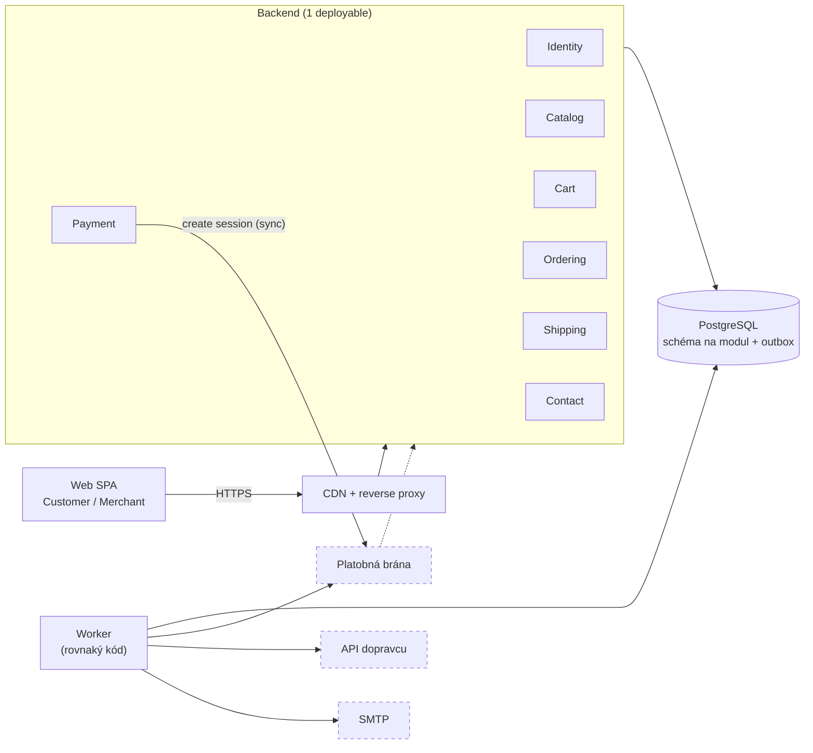
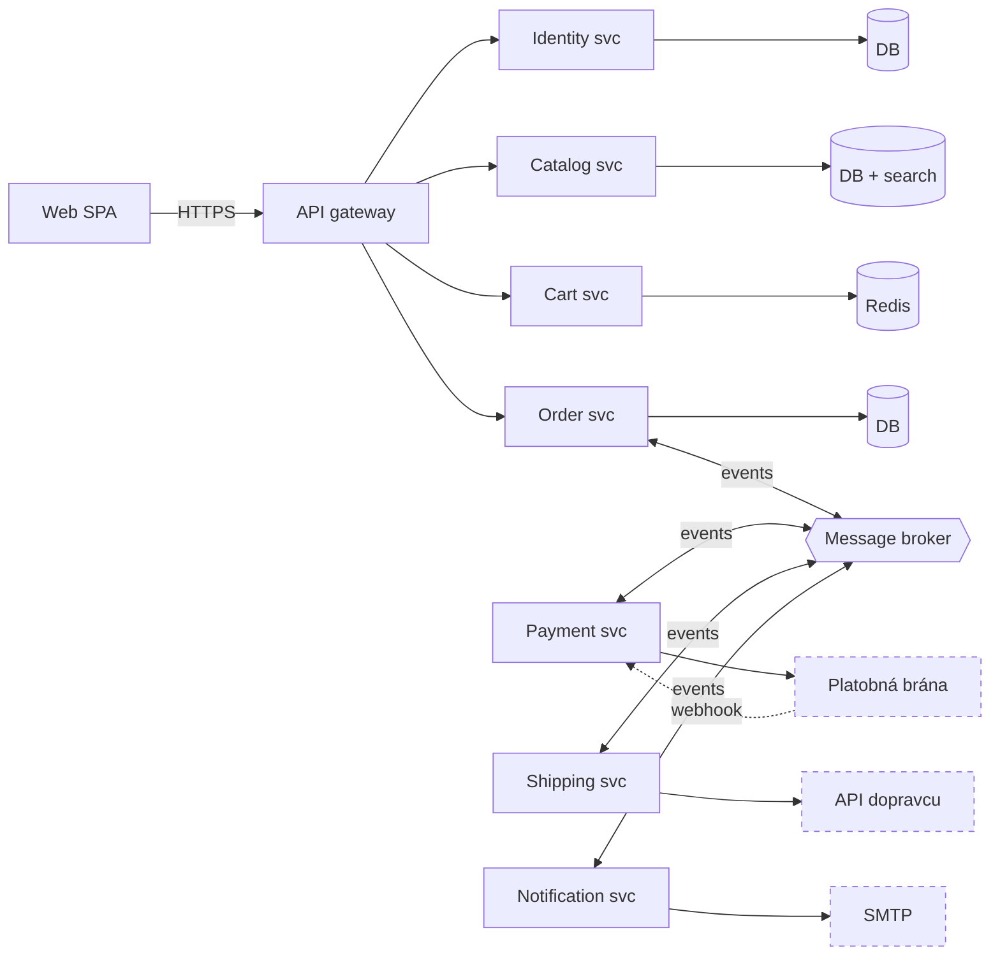
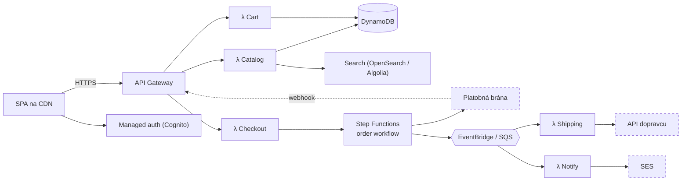

# NOTES – Architektúry pre CDC Shop

Priebežné poznámky z návrhu architektúry. Nie je to prepis rozhovoru – je to stav poznania po každej výmene.
Požiadavky: [data/CDC.txt](data/CDC.txt) · Výstup: [ADR.md](ADR.md) · Váhovanie: [drivers.json](drivers.json)

## Session metrics

| Metric                        | Value                                      |
| ----------------------------- | ------------------------------------------ |
| Start / end                   | 2026-11-01 13:40 / 2026-11-01 13:55        |
| User questions (Task 1)       | 1 (zadanie: navrhni 3 architektúry + ADR) |
| Corrections I made            | 0                                          |
| User change requests (Task 2) | 0                                          |
| ADR versions                  | 1                                          |

**Poznámka k priebehu:** Používateľ zadal úlohu naraz (3 architektúry + ADR pre najvhodnejšiu). Setup otázky
a otázky na nejasnosti preto neboli položené samostatne – použil som predvolené hodnoty skillu a všetky
odvodené predpoklady sú označené ako *odvodené / na potvrdenie*. ADR má preto status **Proposed**.

---

## 1. Zhrnutie systému

**Čo to je:** CDC Shop je e-shop so stavebným / železiarskym materiálom. Zákazník si prezerá katalóg (zoznam,
detail, hľadanie podľa názvu, triedenie podľa ceny), vkladá produkty do košíka, platí a sleduje stav zásielky.
Obchodník (Merchant) spravuje produkty a ceny. Špecifikácia nazýva systém **„distributed system“** a pokrýva
správu produktov, platbu a doručenie.

**Roly:**

| Rola                           | Čo robí                                                                                                         |
| ------------------------------ | ----------------------------------------------------------------------------------------------------------------- |
| Customer                       | registrácia, login/logout, profil, katalóg, košík, platba, sledovanie objednávky, kontakt (US 1–12, 23–25) |
| Merchant                       | login/logout, profil, katalóg, zmena ceny, pridanie/odobratie produktu (US 13–22)                               |
| Platobná brána (implicitná) | spracovanie platby kartou, webhook o výsledku (US 7)                                                             |
| Dopravca (implicitný)         | vytvorenie zásielky, stav balíka (US 9)                                                                         |
| E-mail / SMTP (implicitný)    | kontaktný formulár, potvrdenia (US 23)                                                                          |

**Funkčné oblasti (bounded contexts):**

- **Identity** – registrácia, login, logout, profil, roly (US 1, 2, 3, 8, 13, 14, 19)
- **Catalog** – zoznam, detail, hľadanie podľa názvu, triedenie podľa ceny, správa produktov a cien (US 5, 6, 11, 12, 15, 16, 17, 18, 21, 22)
- **Cart** – zobrazenie, pridanie, vyprázdnenie košíka (US 4, 24, 25)
- **Ordering + Payment** – vytvorenie objednávky z košíka, platba (US 7)
- **Shipping** – stav balíka (US 9)
- **Content / Contact** – About Us, kontakt (US 10, 20, 23)

**Nefunkčné požiadavky (odvodené – v špecifikácii nie sú):**

- *Hygienické (nerozhodujú voľbu):* údaje o karte sa neukladajú (hosted payment page, PCI DSS SAQ-A), hashovanie hesiel (Argon2/bcrypt), RBAC Customer/Merchant, HTTPS, GDPR (export/výmaz profilu), zálohy DB.
- *Rozhodujúce:* prevádzkovateľnosť malým tímom, rýchlosť dodania MVP, konzistencia objednávka ↔ platba, škálovanie pri špičkách (sezóna, akcie), izolácia výpadkov (napr. dopravca nedostupný), náklady, vendor lock-in.

**Nejasnosti a medzery (podľa dopadu na architektúru):**

1. **Jeden obchod alebo marketplace?** „Merchant page“ a „my profile“ môžu znamenať viac obchodníkov. Marketplace mení vlastníctvo produktov, výplaty (split payments) a izoláciu dát.
2. **Sklad / zásoby** nie sú spomenuté – bez nich odpadá rezervácia zásob a väčšina ságy pri objednávke.
3. **Nikto na strane obchodníka nevidí ani neexpeduje objednávky**, no US 9 ukazuje stav balíka → chýba príbeh „Merchant spracuje objednávku“ alebo integrácia s dopravcom.
4. **„Distributed system“** – je to požiadavka na mikroslužby, alebo len opis (klient, server, platobná brána, dopravca)?
5. Hosťovský nákup (bez registrácie)? Košík pre neprihláseného?
6. Odstránenie produktu, ktorý je v košíku alebo v starej objednávke (US 16) → soft delete + snapshot ceny v položke objednávky.
7. Zmena ceny (US 15) počas toho, ako ju má zákazník v košíku – ktorá cena platí?
8. Kontakt (US 23) – e-mail, formulár, alebo ticketing?

**Pracovné predpoklady (odvodené, na potvrdenie):** 1 obchod, ≤ 10 000 produktov, ~50 000 návštev/mesiac,
~2 000 objednávok/mesiac, špička 10× priemer (≈ 50 req/s), dáta < 10 GB, tím 2–4 vývojári bez samostatného ops,
dostupnosť 99,5 %, p95 latencia katalógu < 300 ms.

---

## 2. Tri navrhnuté architektúry

Osi, na ktorých sa líšia: **granularita nasadenia** (1 deployable vs. nezávislé služby), **prevádzkový model**
(vlastný beh / PaaS vs. serverless / managed), **model konzistencie** (lokálna ACID transakcia vs. sága / eventual consistency).

### A′) Modulárny monolit + asynchrónny worker

- **Komponenty:** SPA (web) → reverse proxy / CDN → jedna backend aplikácia s modulmi Identity, Catalog, Cart, Ordering, Payment, Shipping, Contact → jedna PostgreSQL (schéma na modul) → worker proces (rovnaký kód, iný entrypoint) s frontou úloh v PostgreSQL (outbox / job tabuľka) → platobná brána, API dopravcu, SMTP.
- **Komunikácia:** moduly volajú len verejné fasády iných modulov (in-process); doménové udalosti cez outbox → worker. Volania externých systémov robí worker, **s výnimkou** vytvorenia platobnej session (synchrónne, používateľ čaká na redirect).
- **Kľúčové mechanizmy:** stavový automat objednávky, idempotentný webhook handler (unikátne `provider_event_id`), transactional outbox, snapshot ceny v položke objednávky, full-text / trigram hľadanie v PostgreSQL, soft delete produktu, architektonické testy hraníc modulov.
- **+ Výhody:**
  - Objednávka + položky + outbox v jednej ACID transakcii – žiadna sága pre US 7.
  - Jeden deploy, jeden log, jeden debugger – zvládne tím 2–4 ľudí.
  - Najrýchlejšia cesta k MVP; lacná prevádzka (1–2 VM / PaaS + managed PostgreSQL).
  - Worker izoluje pomalé / nedostupné externé systémy od HTTP požiadaviek.
- **– Nevýhody:**
  - Škáluje sa celý celok (katalóg sa nedá škálovať zvlášť – rieši sa CDN a read replikou).
  - Hranice modulov drží len disciplína + testy; bez nich hrozí „big ball of mud“.
  - Chyba v jednom module (napr. memory leak) zhodí všetko.
  - Nespĺňa „distributed“, ak sa to číta ako „mikroslužby“ (nejasnosť 4).
- **Najťažšie na implementáciu:**
  - Platba mimo našej DB transakcie (US 7): webhook môže prísť skôr ako redirect, dvakrát, alebo vôbec → idempotencia + rekonsiliácia (worker periodicky dopytuje bránu na `PAYMENT_PENDING` > 30 min).
  - Zmena ceny (US 15) vs. košík (US 4, 24) – cena sa prepočíta pri checkoute, v objednávke sa zmrazí.
  - Odstránenie produktu (US 16) odkazovaného z objednávok → soft delete.
  - Hľadanie podľa názvu s diakritikou a preklepmi (US 6, 18) – `unaccent` + `pg_trgm`.
- **Kedy ju zvoliť:** 1–8 vývojárov, jeden obchod, MVP, stredná záťaž, potreba rýchlo dodať.
- **Minimálna rozumná verzia:** monolit bez workera (A); A′ pridáva worker – odporúčaný minimálny variant, lebo externé volania nepatria do HTTP požiadavky.

### B) Mikroslužby + udalosti (sága)

- **Komponenty:** SPA → API gateway (auth, routing) → služby Identity, Catalog (+ search index), Cart (Redis), Order, Payment, Shipping, Notification – každá s vlastnou DB → message broker (RabbitMQ / Kafka) → externé systémy.
- **Komunikácia:** čítania synchrónne cez REST/gRPC za gateway; checkout ako choreografická alebo orchestrovaná sága cez broker (`OrderCreated` → `PaymentRequested` → `PaymentSucceeded` → `ShipmentRequested`).
- **Kľúčové mechanizmy:** outbox v každej službe, idempotentní konzumenti, sága s kompenzáciami, korelačné ID + distribuovaný tracing, kópia ceny/názvu produktu v Order (read model), service discovery, kontrakty udalostí (schema registry).
- **+ Výhody:**
  - Nezávislé škálovanie (Catalog/Search pri špičke, Payment nie).
  - Izolácia výpadkov – pád Shipping nezastaví nákupy.
  - Nezávislé deploye pre viac tímov; doslovne spĺňa „distributed system“.
  - Rôzne úložiská podľa potreby (Redis pre košík, Elasticsearch pre hľadanie).
- **– Nevýhody:**
  - Prevádzka (K8s, broker, tracing, N databáz) je pre 2–4 ľudí neúnosná.
  - Eventual consistency: cena v košíku vs. Catalog, stav objednávky vs. platby.
  - Debugovanie incidentu cez 5 služieb a broker; testovanie kontraktov.
  - Najvyššie náklady na ľudí aj infraštruktúru.
- **Najťažšie na implementáciu:**
  - Sága checkoutu (US 7, 24, 25): kompenzácie, timeouty, duplicitné správy, poradie udalostí.
  - Zmena ceny (US 15) musí doputovať do Cart a Order – ktorá kópia je pravda?
  - Odstránenie produktu (US 16) – udalosť `ProductRemoved` a jej spracovanie v Cart.
  - Lokálny vývoj (docker-compose s 8+ kontajnermi) a end-to-end testy.
- **Kedy ju zvoliť:** 3+ tímy, desiatky vývojárov, rôzne profily záťaže, potreba nezávislých release cyklov, marketplace.
- **Minimálna rozumná verzia:** 3 služby s vlastnými DB – *Storefront* (Identity + Catalog + Cart), *Order & Payment*, *Fulfilment* (Shipping + Notification) + broker. Pozorovanie: to je v podstate A′ po dvoch extrakciách modulov.

### C) Serverless / managed služby (BaaS)

- **Komponenty:** statická SPA na CDN (S3 + CloudFront) → managed auth (Cognito / Auth0) → API Gateway → Lambda funkcie podľa oblastí → DynamoDB (alebo Aurora Serverless) → EventBridge / SQS + Step Functions pre checkout → platobná brána, dopravca, SES.
- **Komunikácia:** synchrónne HTTP → Lambda; asynchrónne udalosti cez EventBridge/SQS; workflow platby a expedície v Step Functions.
- **Kľúčové mechanizmy:** single-table design v DynamoDB (prístupové vzory vopred), idempotentné Lambdy (idempotency key tabuľka), Step Functions ako stavový automat objednávky, DLQ pre zlyhané udalosti, IaC (CDK/Terraform), managed vyhľadávanie (OpenSearch Serverless / Algolia).
- **+ Výhody:**
  - Žiadne servery; automatické škálovanie aj na nulu – platí sa za použitie.
  - Managed auth rieši US 1, 2, 8, 13, 14 takmer bez kódu.
  - Step Functions dávajú vizuálny, auditovateľný stavový automat checkoutu.
  - Vysoká dostupnosť „zadarmo“ (multi-AZ).
- **– Nevýhody:**
  - Vendor lock-in (Lambda, DynamoDB, Step Functions, Cognito).
  - Triedenie podľa ceny + hľadanie podľa názvu (US 5, 6, 17, 18) je v DynamoDB nepohodlné → treba ďalšiu službu (OpenSearch/Algolia).
  - Lokálny vývoj a testovanie sú ťažšie (emulátory, LocalStack); cold starty.
  - Distribuované ladenie (X-Ray) a veľa IAM konfigurácie.
- **Najťažšie na implementáciu:**
  - Dátový model DynamoDB pre katalóg so sortom a full-textom; zmena ceny (US 15) musí aktualizovať index.
  - Konzistencia objednávky a platby bez ACID naprieč tabuľkami (US 7) – TransactWriteItems má limity, zvyšok cez Step Functions.
  - Prístupové práva Merchant vs. Customer v Cognito groups + IAM / Lambda authorizer.
  - Náklady pri náhlom náraste (neohraničené škálovanie, OpenSearch má minimálnu cenu).
- **Kedy ju zvoliť:** tím, ktorý už pozná AWS serverless, veľmi nárazová záťaž, preferencia OPEX bez prevádzky serverov.
- **Minimálna rozumná verzia:** SPA + managed auth + API Gateway + niekoľko Lambd + jedna relačná managed DB (Aurora Serverless / Supabase) – teda „serverless monolit“; Step Functions až pre checkout.

### Esenciálna vs. akcidentálna zložitosť

- **Esenciálna (má každá možnosť, vyplýva z domény):** platba mimo našej transakcie (webhooky, idempotencia, rekonsiliácia), stavový automat objednávky, snapshot ceny pri objednávke, soft delete produktov, hľadanie s diakritikou, RBAC Customer/Merchant, integrácia s dopravcom.
- **Akcidentálna – B pridáva:** ságu s kompenzáciami pre tok, ktorý je v monolite jedna transakcia; replikáciu cien medzi službami; broker, tracing, N databáz, kontrakty udalostí.
- **Akcidentálna – C pridáva:** dátové modelovanie pre DynamoDB a samostatný search index; IAM; emulátory pre lokálny vývoj; lock-in.
- **Akcidentálna – A′ pridáva:** strážiť hranice modulov testami; outbox/job tabuľku (malá cena).

**Predvolené odporúčanie:** **A′ – modulárny monolit + worker.** Esenciálne problémy sú vo všetkých troch rovnaké,
A′ k nim pridáva najmenej vlastných a pri predpokladanej záťaži (~50 req/s v špičke) netreba nezávislé škálovanie.
„Distributed“ je splnené na úrovni systému (SPA, backend, worker, DB, brána, dopravca komunikujú cez sieť);
deployment granularity a distribúcia sú nezávislé osi.

---

## 3. Log diskusie

- **2026-11-01 – štart:** Zadanie: použiť skill `architecture-adr`, navrhnúť 3 architektúry pre [CDC.txt](data/CDC.txt) a vytvoriť ADR pre najvhodnejšiu. Predvolené voľby skillu: ADR v angličtine, poznámky v slovenčine, jeden súbor `ADR.md` s ADR logom, šablóna MADR (shortened).
- **Výber architektúr:** A′ modulárny monolit + worker, B mikroslužby + sága, C serverless/managed. Líšia sa granularitou nasadenia, prevádzkovým modelom aj modelom konzistencie.
- **Rozhodovacia tabuľka:** 7 driverov, váhy v [drivers.json](drivers.json), výpočet `weighted_score.py`: A′ 4,70 · C 3,80 · B 2,45. A′ vyhráva vo všetkých 4 scenároch citlivosti. Break-even: C predbehne A′ až keď škálovateľnosť alebo izolácia výpadkov dosiahne váhu ~52,6 % (pri báze 10 %) – teda len ak by sa stali vylučovacím kritériom.
  - Zdôvodnenie váh: (1) prevádzka tímom 2–4 – 25 %, najdrahší zdroj sú ľudia; (2) čas do prvého vydania – 20 %, MVP e-shopu; (3) konzistencia objednávka/platba – 20 %, chyba = strata peňazí/dôvery; (4) škálovanie – 10 %, záťaž je malá, špičky rieši CDN; (5) izolácia výpadkov – 10 %, externé volania aj tak izoluje worker; (6) náklady – 10 %, infra je šum, dominujú ľudia; (7) lock-in – 5 %, sekundárne riziko.
- **ADR v1:** [ADR.md](ADR.md) – ADR-001 (štýl architektúry) a ADR-002 (platobný tok a stavový automat objednávky). Plánované: ADR-003 identita a session, ADR-004 hľadanie v katalógu, ADR-005 technologický stack.

## 4. Otvorené otázky / rozhodnutia

- [ ]  Jeden obchod vs. marketplace? → v ADR: **predpoklad jeden obchod**, otvorená otázka 1 (marketplace = nový ADR).
- [ ]  Sklad / zásoby? → v ADR: **mimo rozsahu MVP**, otvorená otázka 2.
- [ ]  Kto expeduje objednávky a odkiaľ je stav balíka (US 9)? → v ADR: integrácia s API dopravcu cez worker, otvorená otázka 3.
- [ ]  Znamená „distributed system“ požiadavku na mikroslužby? → v ADR: **interpretované ako opis systému**, otvorená otázka 4.
- [ ]  Potvrdiť pracovné predpoklady (záťaž, tím, dostupnosť) – zatiaľ *odvodené*, nepotvrdené používateľom.
- [ ]  Jazyk a forma ADR → **predvolené skillu (EN, jeden súbor ADR.md, MADR shortened)**, používateľ ich zatiaľ nemenil.
