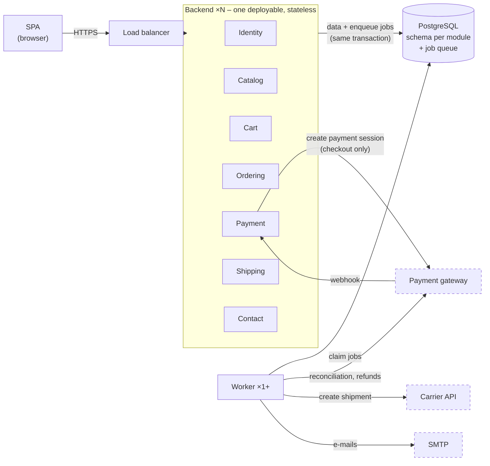
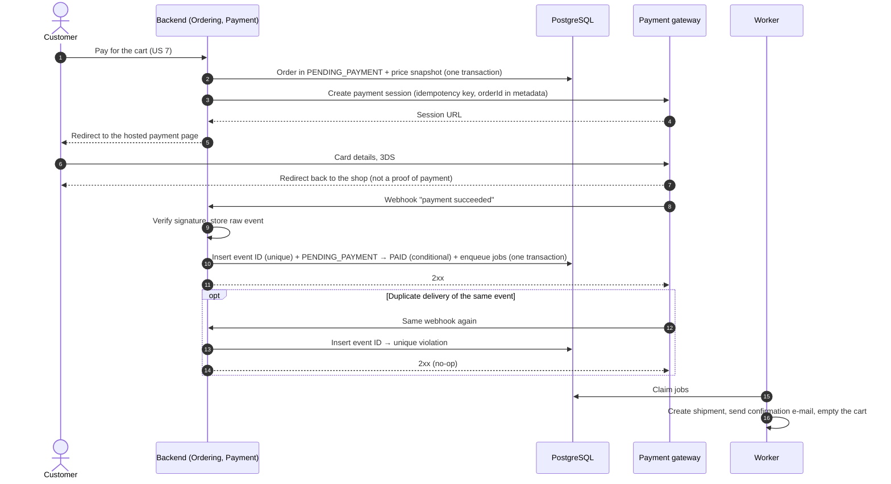
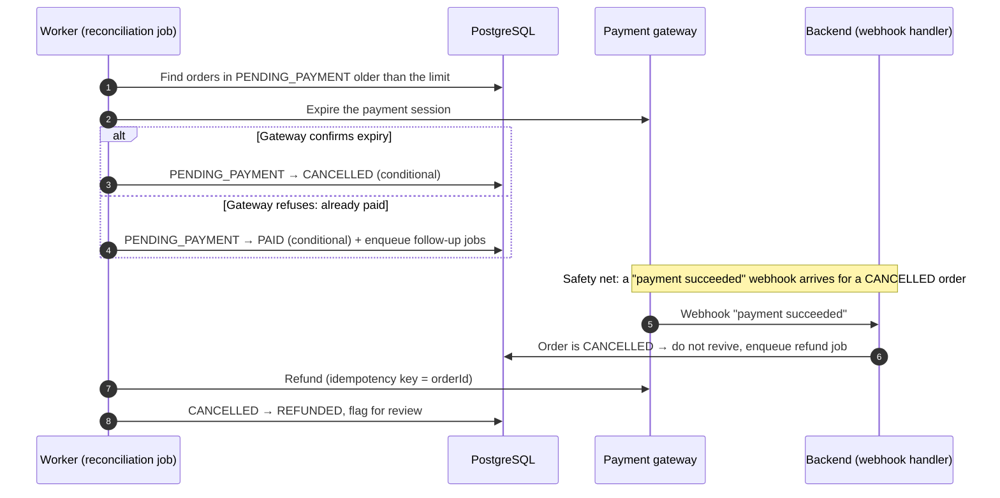
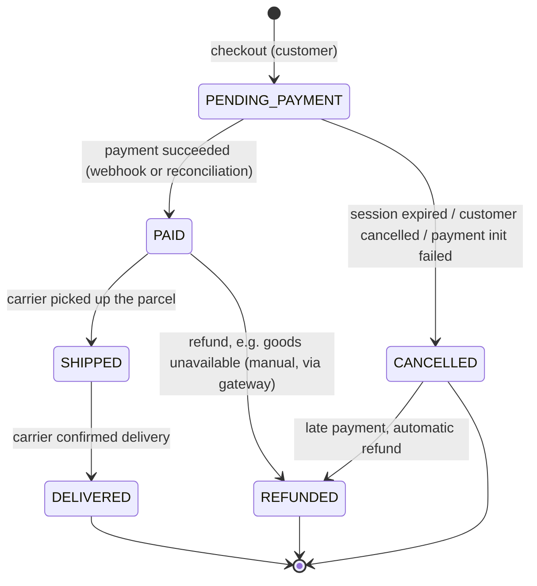

# Architecture Decision Records – CDC Shop

This file contains all architecture decision records for CDC Shop. Each record captures one decision and can be read on its own.

**Template:** MADR (shortened) · **Sources:** [data/CDC.txt](data/CDC.txt) (requirements), [NOTES.md](NOTES.md) (discussion of the alternatives)

| ID | Decision | Status | In one sentence |
|---|---|---|---|
| [ADR-001](#adr-001) | System architecture | Proposed | Modular monolith with a separate worker process and one PostgreSQL database |
| [ADR-002](#adr-002) | Payments and webhooks | Proposed | Hosted payment page, idempotent webhooks, the gateway as the source of truth, reconciliation |
| [ADR-003](#adr-003) | Job queue | Proposed | Worker jobs stored in a PostgreSQL table, written in the same transaction as the business change |

Planned: ADR-004 identity and sessions, ADR-005 search in PostgreSQL, ADR-006 technology stack.

---

## ADR-001: CDC Shop system architecture – modular monolith with an asynchronous worker

| | |
|---|---|
| **Status** | Proposed |
| **Date** | 2026-11-01 |
| **Decision maker** | Ján Murin |
| **Follow-up ADRs** | [ADR-002](#adr-002), [ADR-003](#adr-003) |

> **Summary.** We will build CDC Shop as a modular monolith with a separate worker process and a single PostgreSQL database. The main reason: a small team can build and run it for a fraction of the cost of microservices, payments stay consistent thanks to database transactions, and even 100,000 orders per month do not require splitting the business logic into services. The price is that the whole backend is scaled and deployed as one unit, and module boundaries must be actively enforced by tests. It is still open whether the client means separate services by "distributed system"; if so, we will move to three services by extracting modules.

### 1. Context and problem

CDC Shop is an online shop for a hardware store. The specification has 25 user stories for two roles, Customer and Merchant, in these areas: identity, catalog with search and sorting, product and price management, shopping cart, payment, shipment information, About Us and contact. Payment and delivery depend on external systems (payment gateway, carrier). The specification describes the system as **distributed**.

**Scope:** a single shop (not a marketplace), no inventory management, cart only for signed-in customers.

**Confirmed assumptions** (the specification states no non-functional requirements; these values were derived in the discussion and confirmed by the decision maker on 2026-11-01, see [NOTES.md](NOTES.md)): ~1,000 orders per month growing up to ~100,000, a catalog of up to 5,000 items, a team of 2–4 developers with no dedicated operations person, 99.5% availability, catalog responses under 500 ms for 95% of requests. Card data never reaches our systems (PCI DSS). GDPR applies.

### 2. Considered options

- **A′: Modular monolith with a worker.** One backend split into modules by domain, a separate worker for asynchronous jobs, one PostgreSQL database.
- **B: Microservices with a saga.** Separate services with their own databases, an API gateway, a message broker, checkout implemented as a saga. The minimal variant has 3 services (Catalog, Ordering, Shipping).
- **C: Serverless on AWS.** Lambda, API Gateway, Step Functions, Cognito, Aurora Serverless v2.

### 3. Decision drivers and weighted comparison

Score: 1 = very poor, 3 = partial, 5 = excellent. The maximum is 5.00.

| Driver | Weight | A′ | B | C |
|---|---|---|---|---|
| 1. Operable by a team of 2–4 people | 25% | 5 | 1 | 4 |
| 2. Payment consistency | 20% | 5 | 3 | 3 |
| 3. Cost at 1,000 orders/month (people + infrastructure) | 20% | 5 (~€3–6.5k) | 1 (~€13–20k) | 4 (~€3–6.5k) |
| 4. Growth to 100,000 orders/month without a rewrite | 15% | 4 | 5 | 5 |
| 5. "Distributed system" | 10% | 3 | 5 | 4 |
| 6. Low vendor lock-in | 10% | 5 | 4 | 1 |
| **Weighted score** | | **4.65** | **2.70** | **3.65** |

- **B** loses on operability and cost. The saga, outbox, eventual consistency and its own platform are too much for a team of 2–4 people. At 1,000 orders per month, IT costs would exceed the shop's gross margin (~€12–15k/month).
- **C** loses on lock-in and consistency. Cognito does not export password hashes and Step Functions are proprietary, so a migration would take ~15+ person-weeks. The system cannot be run faithfully on a local machine.
Costs are order-of-magnitude estimates (full cost of one FTE ~€6,000/month), not a verified budget.

**Sensitivity analysis.** Method: one weight is changed and the remaining weights are rescaled proportionally so that they again add up to 100%. Scores stay the same unless stated otherwise.

| Scenario | Weights for drivers 1–6 | A′ | B | C |
|---|---|---|---|---|
| Base | 25 / 20 / 20 / 15 / 10 / 10 | **4.65** | 2.70 | 3.65 |
| Driver 5 raised to 30% (others × 70/90) | 19.4 / 15.6 / 15.6 / 11.7 / **30** / 7.8 | **4.28** | 3.21 | 3.73 |
| Team knows AWS: C scores 5 on driver 1; driver 6 set to 0% (others × 100/90) | 27.8 / 22.2 / 22.2 / 16.7 / 11.1 / **0** | **4.61** | 2.56 | 4.22 |

- A′ comes out on top in all three scenarios. C gets close only when the team knows AWS well and lock-in does not matter.
- **Break-even point:** with the same method, A′ stays first as long as the weight of driver 5 is below **~54%**. Above that, B wins. C never wins on driver 5 alone: it ties with A′ only at ~55%, where B is already ahead.
- B would therefore win only if driver 5 effectively became a knock-out criterion. That is covered by open question 1.

### 4. Decision

**Chosen option: A′.**

Dashed boxes are external systems. Only the worker calls them, with the single exception of creating the payment session at checkout.

**Rationale**
- **Load:** 100,000 orders per month is ~0.04 orders per second. More instances, a read replica and caching are enough.
- **Complexity:** the essential problems (payment outside our transaction, an unreliable carrier, price changes) are the same for every option. A′ adds the fewest problems of its own.
- **Worker:** calls to external systems happen outside web requests, so a carrier outage does not stop checkout. The system consists of several independently running processes.
- **Way out:** modules with their own schemas can be extracted into services. The minimal variant of B is essentially A′ after extracting Catalog/Search and Shipping.

**Rules that are part of this decision**
- A module exposes only a facade and DTOs, owns its schema and refers to other modules only by ID (no foreign keys or table joins across modules).
- Only the worker calls external systems. The exception is creating the payment session during checkout ([ADR-002](#adr-002)).
- The backend is stateless: at least 2 instances behind a load balancer, managed PostgreSQL with backups and failover.

### 5. Consequences

- ✅ Orders and payments live in one database with ACID transactions.
- ✅ The whole system runs locally. Debugging happens in one process and one database.
- ✅ Lowest development cost (~8–12 person-months for the MVP) and operating cost. Low lock-in.
- ❌ The whole backend is scaled and deployed at once. A bug in one module can affect the whole process.
- ❌ Module boundaries must be enforced. Cross-module views are composed through facades.
- ⚠️ **Risks:**
  - erosion of module boundaries (mitigation in section 6),
  - PostgreSQL as a single point of failure (managed failover),
  - a different interpretation of "distributed" by the client (question 1).

### 6. Confirmation and review

- **Architecture tests in CI** fail the build when:
  - a module reaches into another module's internals,
  - a dependency cycle appears,
  - an outbound call to an external system (gateway, carrier or SMTP client) is made from anywhere other than an **allowlist**: the worker's job handlers, plus one named adapter in the Payment module that creates the payment session during checkout ([ADR-002](#adr-002)). Verifying a webhook signature makes no network call and is not covered by this rule.
- **Each module has its own database user** with access only to its own schema.
- **Metrics are tagged with the module name.** The ADR is reviewed after the MVP launch and quarterly after that.
- **Revisit** when a signal persists even after cheap measures:
  - one module degrades the others,
  - repeated incidents take down the whole shop,
  - 2+ teams block each other's deployments,
  - a new channel arrives (mobile app, SSO).

  Extraction order: Search, then Shipping, then Identity.

### 7. Open questions

1. **What does the client mean by "distributed system"?** Our interpretation: components run on several nodes and communicate over the network. A monolith defines the deployment granularity, not distribution. If the client requires separate services, we will move to the minimal variant of B and supersede this ADR with a new one.
2. **How is the shipment status updated (US 9)?** Carrier integration, or a missing user story "merchant marks an order as shipped"?
3. **Choice of carrier** and handling of the contact form (e-mail only, or also ticketing).
4. **Technology stack** will be covered by a separate ADR.

---

## ADR-002: Payments via a hosted payment page, idempotent webhooks and reconciliation

| | |
|---|---|
| **Status** | Proposed |
| **Date** | 2026-11-01 |
| **Decision maker** | Ján Murin |
| **Builds on** | [ADR-001](#adr-001) |
| **Related to** | [ADR-003](#adr-003) |

> **Summary.** The customer pays on the payment gateway's hosted page, and we learn the result through a webhook that we process idempotently. The source of truth about a payment is always the gateway, never our timer or the customer returning to our site. A reconciliation job settles orders for which no webhook arrived. The price is a more complex flow (state machine, deduplication, reconciliation) and limited control over the look of the payment page.

### 1. Context and problem

Payment (US 7) happens in an external system, and therefore **outside our database transaction**. Gateways deliver webhooks *at least once*: an event may arrive several times, concurrently on several instances, out of order, or not at all. A customer may also complete the payment just after we have cancelled the order. We do not manage inventory, so the only compensation is a refund.

### 2. Decision drivers

- Card data never reaches our systems (smallest possible PCI DSS scope).
- An order is never paid twice, and a paid order is never lost.
- We detect problems before the customer does.
- Suitable for a team of 2–4 people.

### 3. Considered options

| Option | Pros | Cons |
|---|---|---|
| **Hosted payment page + webhooks + reconciliation** (chosen) | PCI SAQ-A (smallest scope); the gateway handles 3DS and payment methods | redirect away from our site, limited styling |
| Embedded payment fields on our page | smoother UX, our own styling | larger PCI scope (SAQ A-EP), more responsibility for page security |
| Confirmation based only on the customer returning to our site (no webhooks) | simple | **unreliable:** the customer may close the browser and the return URL can be forged, so rejected |

### 4. Decision

**Payment flow:**
1. At checkout, one transaction creates the order in `PENDING_PAYMENT` with a **price snapshot**.
2. The backend synchronously creates a payment session with an **idempotency key** and the `orderId` in its metadata. It redirects the customer to the gateway.
3. **Webhook handler:**
   - verifies the signature and stores the raw event,
   - in one transaction records the event ID (unique constraint, so duplicates are ignored) and conditionally changes the state (`PENDING_PAYMENT → PAID`, otherwise nothing),
   - checks the amount and currency,
   - enqueues follow-up jobs ([ADR-003](#adr-003)) and quickly returns 2xx.
4. The worker handles the shipment, the confirmation e-mail and emptying the cart. **The cart is emptied only on `PAID`.**

**Sequence – successful payment, including a duplicate webhook:**

**Sequence – missing webhook and late payment (reconciliation):**

**Order state machine:**

The state changes only through a conditional update (`WHERE state = expected`). Every transition is recorded in a history (actor, reason, source event ID). A declined card is not a state; the customer retries on the gateway, and the order stays in `PENDING_PAYMENT`.

**The gateway is the source of truth:**
- A **reconciliation job** asks the gateway for the actual state of orders that have been in `PENDING_PAYMENT` longer than a set time.
- Before cancelling an order, the job first expires the session at the gateway. If the gateway refuses because it is already paid, the order moves to `PAID`.
- **A payment that arrives after cancellation** is refunded automatically and flagged for review. A cancelled order is never revived.

### 5. Consequences

- ✅ Minimal PCI scope. Duplicate and late webhooks do not cause duplicate shipments or e-mails.
- ✅ The state history and stored raw webhooks make it possible to investigate a complaint such as "I paid, but my order is cancelled" with a few queries.
- ❌ A more complex flow: the state machine, deduplication and reconciliation must be implemented and tested.
- ❌ A redirect away from our site and limited customization of the payment page.

### 6. Confirmation

- Integration tests with the **Stripe CLI** or the gateway's equivalent: duplicate, concurrent, late and missing webhooks.
- An alert **"paid at the gateway, cancelled on our side"** from reconciliation, and a metric for failed webhooks.
- `orderId` as the correlation ID in logs and in payment metadata.

### 7. Open questions

1. **Refunds:** the merchant has no user story for them. For now they are done manually in the gateway dashboard and reach our system through a webhook.
2. **Choice of a specific gateway.** It determines the supported payment methods.
3. **Authorize-then-capture:** capture the money only at shipment? A "goods unavailable" situation would then be handled by voiding the authorization instead of refunding. Downsides: authorizations expire, and some payment methods support it poorly.
4. **Asynchronous payment methods** (bank transfer): how long do we wait before cancelling an order?

---

## ADR-003: Worker job queue in PostgreSQL

| | |
|---|---|
| **Status** | Proposed |
| **Date** | 2026-11-01 |
| **Decision maker** | Ján Murin |
| **Builds on** | [ADR-001](#adr-001) |
| **Related to** | [ADR-002](#adr-002) |

> **Summary.** We store worker jobs in a table in the same PostgreSQL database and write them in the same transaction as the business change that triggers them. The main reason: a job can never be lost, or created without the change that caused it, and we need no additional infrastructure. The price is extra database load and the fact that a job table is not a full pub/sub system. We will move to a broker when load or the extraction of a service requires it.

### 1. Context and problem

The worker ([ADR-001](#adr-001)) runs asynchronous jobs:
- follow-up actions after payment ([ADR-002](#adr-002)),
- creating a shipment with the carrier,
- e-mails,
- scheduled payment reconciliation.

If the business change (e.g. order → `PAID`) were stored in the database and the message in a separate broker, we would have a **dual write**: a crash between the two writes means a lost or orphaned job.

### 2. Decision drivers

- A job is created **atomically** with the business change.
- Retries with backoff and tracking of failed jobs.
- No additional infrastructure for a team without an operations person.
- Throughput with a large margin above ~100,000 orders per month (single-digit jobs per second at peak).

### 3. Considered options

| Option | Pros | Cons |
|---|---|---|
| **Job table in PostgreSQL** (chosen) | atomic with the business change, no extra infrastructure, jobs can be inspected with a SQL query | load on the database, not pub/sub, tied to PostgreSQL |
| RabbitMQ + transactional outbox | standard broker, pub/sub, higher throughput | another system to run, the outbox is needed anyway |
| Managed queue (e.g. SQS) + outbox | no broker to operate | the outbox is needed anyway, tied to a cloud provider |

Both alternatives need an outbox table in PostgreSQL. The chosen option is essentially **an outbox without a broker**.

### 4. Decision

- Job table: type, payload, state, attempt count, next run time, last error.
- **A job is inserted in the same transaction** as the business change.
- Workers claim jobs without blocking each other and without two workers processing the same job (row locking that skips locked rows). Several worker instances can run.
- A failed job is retried with exponential backoff. After exceeding the limit it moves to the `DEAD` state and raises an alert.
- Delivery is **at least once.** A worker may crash after performing the action but before marking the job as done. Therefore **every handler must be idempotent.** Towards the carrier we send an idempotency key based on `orderId`.
- Scheduled jobs (reconciliation) use the next run time.
- Completed jobs are deleted after a retention period so the table does not keep growing.
- We will use an existing library for the chosen stack if it meets the points above. The stack is covered by a separate ADR.

### 5. Consequences

- ✅ No dual write: the job and the business change are either both stored or neither.
- ✅ No additional infrastructure. Job state can be inspected directly in the database.
- ❌ Polling and deleting jobs add load to the database (including vacuum).
- ❌ Not pub/sub. If several independent consumers must react to one event, several jobs must be inserted.
- ❌ Tied to PostgreSQL. When a module is extracted into a service, we will move to an outbox with a broker.

### 6. Confirmation and review

- Metrics **age of the oldest pending job** and **number of jobs in the `DEAD` state**, both with alerts.
- Architecture test: outbound calls to external systems exist only in job handlers, with the single exception of the payment-session adapter used at checkout. The allowlist is the same as in [ADR-001](#adr-001), section 6.
- **Revisit** when the queue noticeably loads the database, job latency grows even with more workers, or when the first module is extracted into a service (e.g. Shipping).
