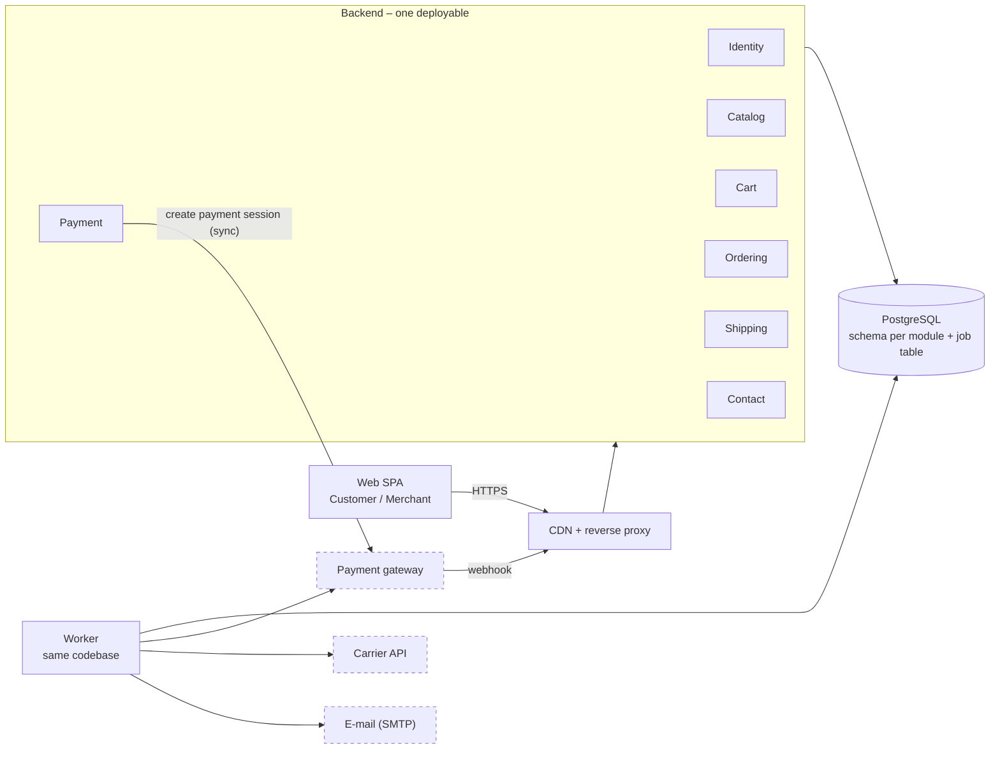
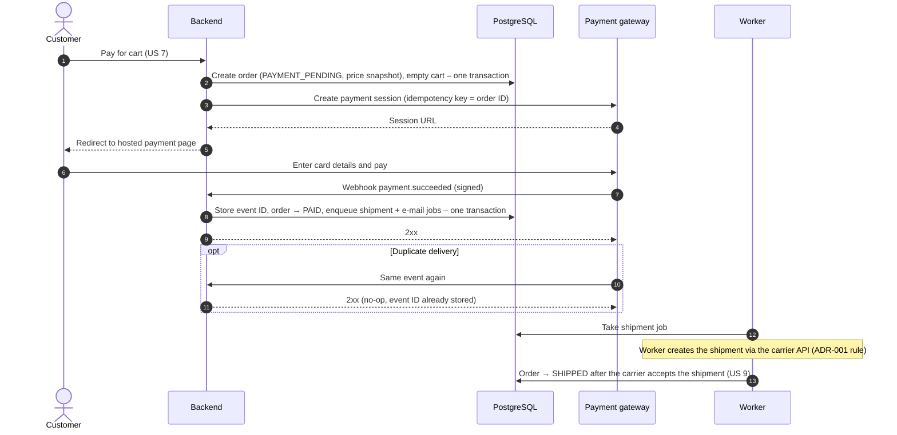
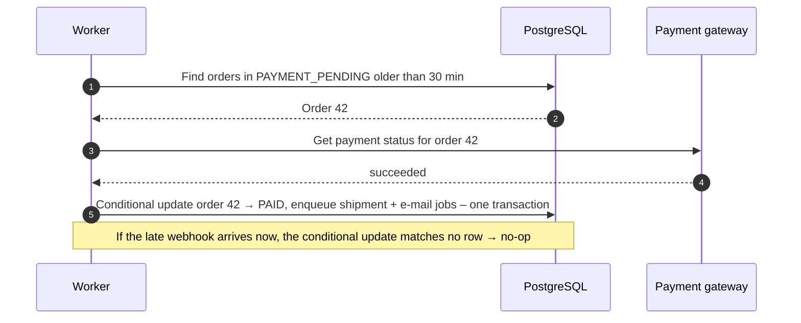
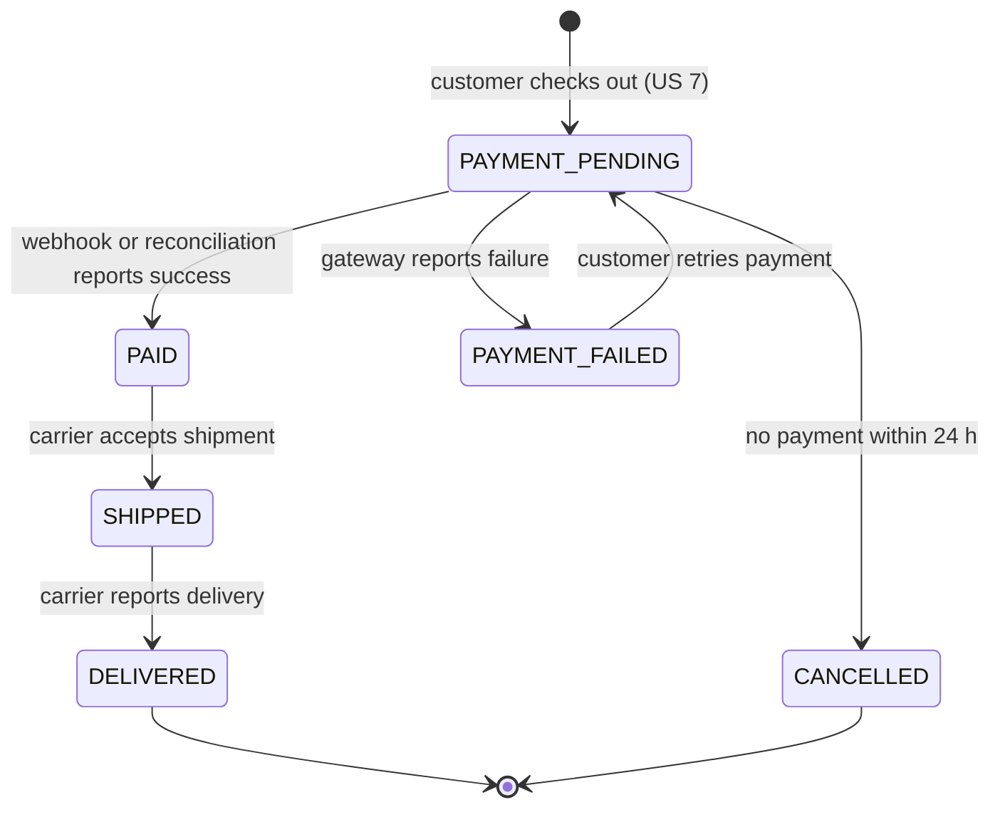

# Architecture Decision Records – CDC Shop

This file contains all architecture decision records for CDC Shop. Each record captures one decision and can be read on its own.

**Template:** MADR (shortened) · **Sources:** [data/CDC.txt](data/CDC.txt) (requirements), [NOTES.md](NOTES.md) (discussion of the alternatives), [drivers.json](drivers.json) (weighted comparison input)

| ID | Decision | Status | In one sentence |
|---|---|---|---|
| [ADR-001](#adr-001) | System architecture | Proposed | Modular monolith with an asynchronous worker on one PostgreSQL database. |
| [ADR-002](#adr-002) | Payment flow and order state machine | Proposed | Hosted payment page, idempotent webhook as the source of truth, periodic reconciliation by the worker. |

Planned: ADR-003 identity and sessions, ADR-004 catalog search, ADR-005 technology stack.

---

## ADR-001: CDC Shop system architecture – modular monolith with an asynchronous worker

| | |
|---|---|
| **Status** | Proposed |
| **Date** | 2026-11-01 |
| **Decision maker** | Ján Murin |
| **Follow-up ADRs** | [ADR-002](#adr-002) |

> **Summary.** We will build CDC Shop as a modular monolith (one backend deployable with strict module boundaries) plus a worker process that handles all slow and external work through a job queue in the same PostgreSQL database. The main reason: a team of 2–4 developers gets ACID consistency for orders and payments and the fastest path to a first release, while the expected load is far below what one deployable can serve. The price is that the system scales and fails as one unit, and module boundaries hold only as long as architecture tests enforce them. It is still open whether the spec's "distributed system" or a marketplace scope would require independent services; if so, we will extract modules in the order given in section 6.

### 1. Context and problem

CDC Shop is an online shop for hardware-store materials. The specification ([CDC.txt](data/CDC.txt)) has 25 user stories for two roles, Customer and Merchant, in these areas: identity (register, login, logout, profile), catalog (list, detail, search by name, sort by price, merchant edits products and prices), cart, payment, shipment status, and static content / contact. It depends on three external systems that the spec implies but does not name: a payment gateway (US 7), a carrier API (US 9) and e-mail (US 23). The spec describes the system as **"a distributed system that handles the management, the payment and the shipment of products"**.

**Scope:** one shop with one merchant organisation; no inventory management; guest checkout not supported in the first release.

**Working assumptions** (the specification states no non-functional requirements; these values were derived in the discussion and are **not yet confirmed** by the decision maker, see [NOTES.md §4](NOTES.md)): ≤ 10,000 products, ~50,000 visits and ~2,000 orders per month, peak 10× average (~50 req/s), data < 10 GB, a team of 2–4 developers without a dedicated ops role, 99.5 % availability, p95 catalog latency < 300 ms. Hygiene requirements – card data never stored (hosted payment page, PCI DSS SAQ-A), password hashing, role-based access, HTTPS, GDPR export/erasure – are met the same way by every option and do not decide the choice.

### 2. Considered options

- **A′: Modular monolith + asynchronous worker.** One backend with modules Identity, Catalog, Cart, Ordering, Payment, Shipping, Contact; one PostgreSQL with a schema per module; a worker process (same codebase) consumes an outbox/job table and talks to external systems.
- **B: Microservices + events (saga).** Seven services with their own databases behind an API gateway, a message broker, and a checkout saga with compensations. The minimal variant is three services (Storefront, Order & Payment, Fulfilment) – effectively A′ after two module extractions.
- **C: Serverless / managed services.** Static SPA on a CDN, managed auth (Cognito), API Gateway + Lambda per area, DynamoDB, Step Functions for the order workflow, EventBridge/SQS, a managed search service.

### 3. Decision drivers and weighted comparison

Score: 1 = very poor, 3 = partial, 5 = excellent. The maximum is 5.00. Weight justifications are in [NOTES.md §3](NOTES.md).

| Driver | Weight | A′ | B | C |
|---|---|---|---|---|
| 1. Operable by a team of 2-4 | 25% | 5 | 1 | 4 |
| 2. Time to first release | 20% | 5 | 2 | 4 |
| 3. Order/payment consistency | 20% | 5 | 2 | 3 |
| 4. Scalability for peaks | 10% | 4 | 5 | 5 |
| 5. Failure isolation | 10% | 3 | 5 | 4 |
| 6. Cost (people + infra) | 10% | 5 | 2 | 4 |
| 7. Low lock-in / portability | 5% | 5 | 4 | 2 |
| **Weighted score** | | **4.70** | 2.45 | 3.80 |

- **B** loses on operability, time to release, consistency and cost. A broker, tracing and seven databases need more operational capacity than 2–4 people have, and checkout (US 7, 24, 25) becomes a saga with compensations instead of one transaction.
- **C** loses on consistency and lock-in. Sorting by price and searching by name (US 5, 6, 17, 18) need a second data store next to DynamoDB, and order/payment consistency relies on Step Functions instead of a database transaction. Its strongest argument – zero servers and automatic scaling – is real but not needed at ~50 req/s.

Costs are order-of-magnitude estimates (infrastructure for A′ roughly €50–150 per month on PaaS + managed PostgreSQL; people dominate the total cost in every option), not a verified budget.

**Sensitivity analysis.** Method: one weight is changed and the remaining weights are rescaled proportionally so that they again add up to 100%. Scores stay the same unless stated otherwise.

| Scenario | Weights for drivers 1-7 | A′ | B | C |
|---|---|---|---|---|
| Base | 25 / 20 / 20 / 10 / 10 / 10 / 5 | **4.70** | 2.45 | 3.80 |
| Scalability raised to 30% | 19.4 / 15.6 / 15.6 / 30 / 7.8 / 7.8 / 3.9 | **4.54** | 3.02 | 4.07 |
| Failure isolation raised to 30% | 19.4 / 15.6 / 15.6 / 7.8 / 30 / 7.8 / 3.9 | **4.32** | 3.02 | 3.84 |
| Team already knows AWS serverless (lock-in 0; C scores 5 on drivers 1 and 2) | 26.3 / 21.1 / 21.1 / 10.5 / 10.5 / 10.5 / 0 | **4.68** | 2.37 | 4.37 |
| Team of 15+ in 3 squads (driver 1 at 10%; B scores 4 on driver 1) | 10 / 24 / 24 / 12 / 12 / 12 / 6 | **4.64** | 3.04 | 3.76 |

- A′ wins in all scenarios. C comes closest when the team already knows AWS serverless (4.37 vs. 4.68).
- **Break-even point:** A′ stays first while the weight of *scalability* (driver 4) or *failure isolation* (driver 5) is below ~52.6%; above that C wins. B ties with A′ only at 72.3% for scalability or 57.6% for failure isolation. Drivers 1, 2, 3, 6 and 7 never change the leader.
- This means B or C would win only if scalability or failure isolation became a knock-out criterion – e.g. a confirmed marketplace with many merchants or traffic far above the working assumptions (open questions 1 and 4).

### 4. Decision

**Chosen option: A′ – modular monolith + asynchronous worker.**

Dashed boxes are external systems. Only the worker calls external systems; the single exception is the Payment module creating a payment session synchronously.

**Rationale**
- **Load:** ~50 req/s at peak is served by one deployable with two instances; catalog reads are cached by the CDN, a read replica is a cheap next step.
- **Complexity:** the essential problems (payment outside our transaction, order state machine, price snapshot, soft delete of products, search with diacritics) exist in every option; A′ adds the fewest of its own.
- **Worker + job table:** keeps slow or unavailable external systems out of the HTTP request path and gives retries without a separate broker. The system remains distributed (browser, backend, worker, database, gateway, carrier communicate over the network) without independently deployed services.
- **Way out:** modules own their schema and expose facades, so a module can be extracted into a service by replacing the facade with an HTTP client and the job table with a broker.

**Rules that are part of this decision**
- A module accesses another module only through its public facade; no module reads or writes another module's schema.
- Calls to external systems run only in the worker, **except** creating the payment session in the Payment module ([ADR-002](#adr-002)). Inbound webhooks are accepted by the backend and only enqueue or apply idempotent state changes.
- Side effects after a business transaction (e-mail, shipment creation) are written to the job table in the same transaction (transactional outbox).
- Backend and worker are built from one codebase and deployed together.

### 5. Consequences

- ✅ Order, order lines and outbox jobs are written in one ACID transaction – no saga for checkout.
- ✅ One deployment, one log stream, one debugger; local development is `docker compose up` with two containers. Infrastructure on the order of €50–150 per month.
- ❌ The whole backend scales and fails as one unit; a defect in one module can take down all of them.
- ❌ Module boundaries are not enforced by the network, only by tests and review.
- ⚠️ **Risks:**
  - boundaries erode into a "big ball of mud" (architecture tests, section 6),
  - the job table becomes a bottleneck at high volume (move to a broker when the signal in section 6 appears),
  - the spec's "distributed system" is read as a mandate for microservices (question 4).

### 6. Confirmation and review

- **Architecture tests in CI** (e.g. ArchUnit / dependency-cruiser) fail the build when:
  - a module imports another module's internals instead of its facade,
  - module dependencies form a cycle,
  - code outside the worker imports an external-system client, outside an **allowlist**: Payment module → payment gateway client, operation *create payment session*.
- Each module uses its own database role with privileges only on its own schema. Metrics and logs are tagged by module. The ADR is reviewed after the first production release and every 6 months after that.
- **Revisit** when a signal persists even after cheap measures (caching, read replica, more instances):
  - p95 catalog latency > 300 ms at the working-assumption load,
  - job-table queue lag > 5 minutes for more than 1 % of jobs,
  - more than 8 developers or two teams blocking each other on releases.

  Extraction order: Catalog + search, then Fulfilment (Shipping + notifications), then Order & Payment.

### 7. Open questions

1. **One shop or a marketplace?** Our interpretation: one shop. If several independent merchants are confirmed, product ownership, payouts and data isolation change, and we will supersede this ADR.
2. **Inventory?** Out of scope for the first release. If stock reservation is required, it is added to the Ordering module in the same transaction.
3. **Who dispatches orders (US 9)?** Our interpretation: the worker creates a shipment via the carrier API after payment; merchant order handling is missing from the spec.
4. **Is "distributed system" a requirement for independent services?** Our interpretation: it describes the system context. If it is a hard requirement, the minimal variant of B (three services) applies.
5. **Working assumptions** in section 1 are to be confirmed by the decision maker.

---

## ADR-002: Payment flow and order state machine

| | |
|---|---|
| **Status** | Proposed |
| **Date** | 2026-11-01 |
| **Decision maker** | Ján Murin |
| **Builds on** | [ADR-001](#adr-001) |

> **Summary.** Customers pay on the payment gateway's hosted page; the gateway's signed webhook, processed idempotently, is the only thing that moves an order to `PAID`. The worker reconciles orders stuck in `PAYMENT_PENDING` by querying the gateway. The price is an extra state machine and a reconciliation job, but card data never touches our system and no payment is lost or applied twice.

### 1. Context and problem

Paying for the cart (US 7) is the only flow where money moves, and it runs outside our database transaction. The customer's redirect back may never arrive (closed tab), the webhook may arrive before the redirect, twice, or late, and the customer may change the cart (US 24, 25) or the merchant the price (US 15) while payment is in progress. Every option in ADR-001 has this problem; this record decides how A′ handles it.

### 2. Decision drivers

- No card data in our system (PCI DSS SAQ-A).
- Exactly-once effect of a payment on an order, despite at-least-once webhook delivery.
- The customer pays the price shown at checkout, regardless of later price changes.
- Recovery without manual work when a webhook is lost.

### 3. Considered options

| Option | Pros | Cons |
|---|---|---|
| **Hosted page + idempotent webhook + reconciliation** (chosen) | SAQ-A; gateway is the source of truth; self-healing | State machine and reconciliation job to build |
| Hosted page, trust the return redirect | Simplest | **Rejected:** redirect can be lost or forged; order stays unpaid or is marked paid without money |
| Embedded card form / direct API | Full control of UX | **Rejected:** card data passes our servers (PCI SAQ D) |

### 4. Decision

1. On checkout, Ordering creates the order with a **price snapshot** of each line and status `PAYMENT_PENDING`, and empties the cart, in one transaction.
2. Payment creates a payment session at the gateway synchronously (the allowlisted exception from [ADR-001](#adr-001)) with the order ID as idempotency key, and redirects the customer.
3. The webhook endpoint verifies the signature, stores `provider_event_id` under a unique constraint, applies the transition with a conditional update (`WHERE status = 'PAYMENT_PENDING'`) and enqueues follow-up jobs in the same transaction. A duplicate event returns 2xx and does nothing.
4. The worker queries the gateway for every order in `PAYMENT_PENDING` older than 30 minutes and applies the same transition; after 24 hours without payment the order is `CANCELLED`.

**Sequence – successful payment:**

**Sequence – lost webhook, recovery by reconciliation:**

**Order state machine:**

Every transition is a conditional update on the current state and is recorded in an `order_status_history` table. Shipment tracking details (US 9) are attributes of the shipment, not order states. Refunds are out of scope for the first release.

### 5. Consequences

- ✅ No card data in our system; PCI scope is SAQ-A.
- ✅ Duplicate, early or lost webhooks cannot double-apply or lose a payment.
- ✅ The customer pays the checkout price; price changes (US 15) and product removal (US 16, soft delete) do not affect existing orders.
- ❌ Two code paths (webhook, reconciliation) lead to the same transition and must share one function.
- ❌ An order can stay `PAYMENT_PENDING` for up to 30 minutes when the webhook is lost.

### 6. Confirmation

- Integration tests with the gateway's sandbox for: duplicate webhook, webhook before redirect, lost webhook resolved by reconciliation, invalid signature rejected.
- Alert when any order stays in `PAYMENT_PENDING` longer than 2 hours or when webhook signature failures exceed 1 % per hour.
- The order ID is the correlation ID in logs of the backend, the worker and the gateway metadata.

### 7. Open questions

1. Which payment gateway (Stripe, GoPay, Adyen…)? Decided in ADR-005 technology stack.
2. Are partial or full refunds required? If so, add `REFUNDED` state and a refund job in a new ADR.
