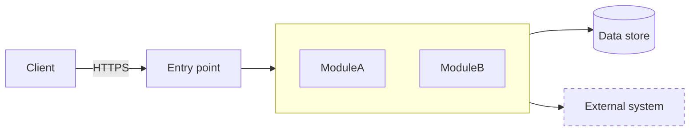
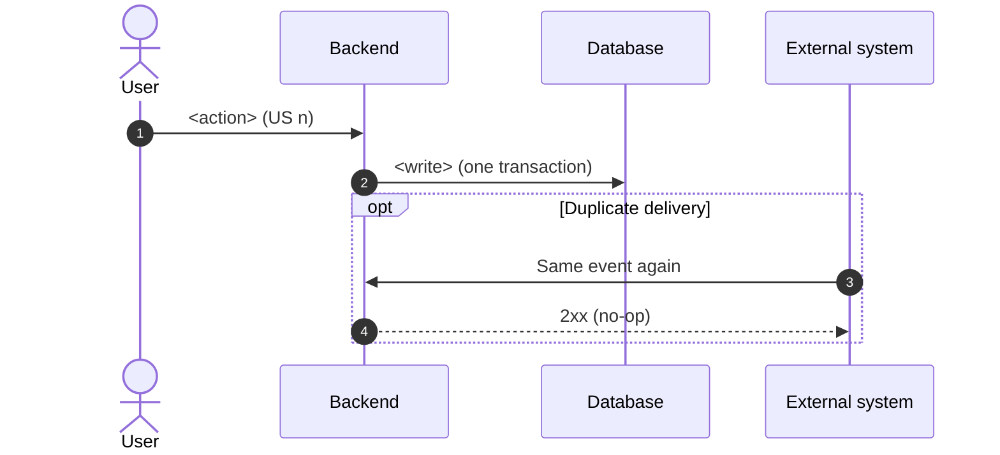
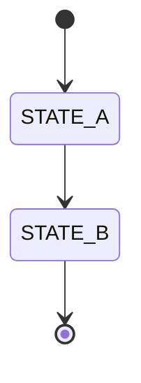

# ADR log template

Final structure from the earlier run (after 7 rounds of user feedback). Replace `<…>` placeholders; delete the
guidance lines in *italics*. One file holds all records; each record stands on its own.

Heading levels: file title `#`, each ADR `##`, its sections `###`. Anchors are explicit `<a id>` tags.

---

```markdown
# Architecture Decision Records – <System>

This file contains all architecture decision records for <System>. Each record captures one decision and can be read on its own.

**Template:** MADR (shortened) · **Sources:** [<requirements file>](<path>) (requirements), [NOTES.md](NOTES.md) (discussion of the alternatives)

| ID | Decision | Status | In one sentence |
|---|---|---|---|
| [ADR-001](#adr-001) | System architecture | Proposed | <style in one line> |
| [ADR-002](#adr-002) | <critical flow, e.g. payments> | Proposed | <…> |

Planned: ADR-00N <topic>, ADR-00M technology stack.

---

<a id="adr-001"></a>

## ADR-001: <System> system architecture – <chosen style>

| | |
|---|---|
| **Status** | Proposed |
| **Date** | <YYYY-MM-DD> |
| **Decision maker** | <name> |
| **Follow-up ADRs** | [ADR-002](#adr-002), … |

> **Summary.** We will build <System> as <style>. The main reason: <1 sentence>. The price is <1 sentence>. It is still open whether <main open question>; if so, we will <fallback>.

### 1. Context and problem

<System> is <one sentence>. The specification has <N> user stories for <roles>, in these areas: <areas in one sentence>. <External dependencies>. <Any wording in the spec that constrains the style, in bold.>

**Scope:** <scope decisions from Phase 1, one line>.

**Confirmed assumptions** (the specification states no non-functional requirements; these values were derived in the discussion and confirmed by the decision maker on <date>, see [NOTES.md](NOTES.md)): <load>, <data size>, <team>, <availability>, <latency>. <Hygiene NFRs in one sentence.>

### 2. Considered options

- **A: <name>.** <one-sentence description>
- **B: <name>.** <one sentence; mention the minimal variant if it was discussed>
- **C: <name>.** <one sentence with the key services>

### 3. Decision drivers and weighted comparison

Score: 1 = very poor, 3 = partial, 5 = excellent. The maximum is 5.00.

<paste the weighted table from weighted_score.py; cells may add a short value, e.g. "5 (~€3–6.5k)">

- **<losing option>** loses on <drivers>. <one or two sentences with the concrete reason>
- **<losing option>** loses on <drivers>. <…>
Costs are order-of-magnitude estimates (<key assumption>), not a verified budget.

**Sensitivity analysis.** Method: one weight is changed and the remaining weights are rescaled proportionally so that they again add up to 100%. Scores stay the same unless stated otherwise.

<paste the scenario table from weighted_score.py – each scenario shows its full weight vector>

- <who wins in all scenarios; when the runner-up gets close>
- **Break-even point:** <from the script: "A stays first while the weight of driver N is below ~X%; above that B wins">
- <what that means: e.g. B would win only if driver N became a knock-out criterion → open question 1>

### 4. Decision

**Chosen option: <X>.**



Dashed boxes are external systems. <one sentence stating the rule the arrows show>

**Rationale**
- **<Load / scale>:** <number-based argument>
- **Complexity:** <essential problems are shared; this option adds the fewest of its own>
- **<Key element of the option>:** <why it matters>
- **Way out:** <how to move to another option later>

**Rules that are part of this decision**
- <boundary rule>
- <communication rule, including any exception and the link to the ADR that needs it>
- <deployment rule>

### 5. Consequences

- ✅ <good>
- ✅ <good, including cost estimate>
- ❌ <bad>
- ❌ <bad>
- ⚠️ **Risks:**
  - <risk> (mitigation in section 6),
  - <risk> (<mitigation>),
  - <risk> (question 1).

### 6. Confirmation and review

- **Architecture tests in CI** fail the build when:
  - <boundary violation>,
  - <dependency cycle>,
  - <communication rule violation> outside an **allowlist**: <exactly the exceptions named in section 4>.
- <other enforcement: DB permissions, metrics tagged by module>. The ADR is reviewed after <milestone> and <cadence> after that.
- **Revisit** when a signal persists even after cheap measures:
  - <measurable signal>,
  - <measurable signal>.

  Extraction order: <first>, then <second>, then <third>.

### 7. Open questions

1. **<question>?** Our interpretation: <…>. If <…>, we will supersede this ADR.
2. <…>

---

<a id="adr-002"></a>

## ADR-002: <decision>

| | |
|---|---|
| **Status** | Proposed |
| **Date** | <YYYY-MM-DD> |
| **Decision maker** | <name> |
| **Builds on** | [ADR-001](#adr-001) |
| **Related to** | [ADR-00N](#adr-00n) |

> **Summary.** <decision>. <main reason>. <price>.

### 1. Context and problem

<why this needs a decision; what makes it hard (e.g. outside our transaction, at-least-once delivery, races)>

### 2. Decision drivers

- <driver>
- <driver>

### 3. Considered options

| Option | Pros | Cons |
|---|---|---|
| **<chosen>** (chosen) | <…> | <…> |
| <alternative> | <…> | <…> |
| <rejected alternative> | <…> | **<why rejected>** |

### 4. Decision

<numbered flow or bullet rules>

**Sequence – <happy path>:**



**Sequence – <failure / recovery path>:** *(separate diagram, not an `alt` inside the first one)*

**<Entity> state machine:**



<rules under the diagram: conditional update, transition history, what is not a state>

### 5. Consequences

- ✅ <…>
- ❌ <…>

### 6. Confirmation

- <test types for the risky cases>
- <alert / metric>
- <correlation ID>

### 7. Open questions

1. <…>
```
